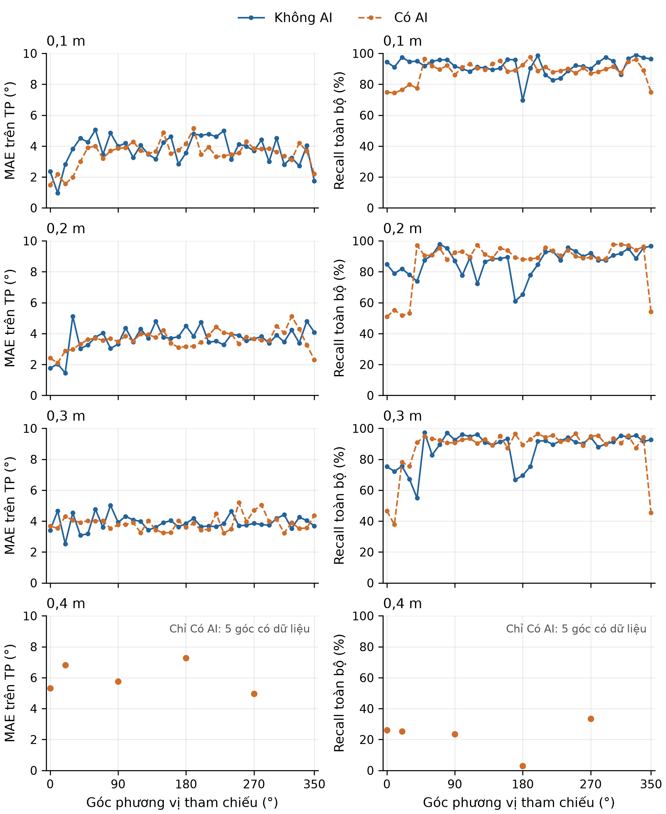

# Bảng chỉ số gộp toàn bộ dữ liệu

Chốt lúc 12/10/2026 21:32:06 (UTC+7). Tổng 8.073 CSV, 14.354.300 khung. Gộp bản ghi thu và dữ liệu mô phỏng vào một bộ dữ liệu hỗn hợp; bảng không tách kết quả theo nguồn gốc. Đây là thống kê của bộ dữ liệu hiện có.

## Bảng 5.2 - Không AI

| Số nguồn | r (m) | MAE (°) | P (%) | R (%) | F1 (%) |
|---|---|---|---|---|---|
| 1 | 0,1 | 3,81 | 90,63 | 90,10 | 90,36 |
| 1 | 0,2 | 3,73 | 85,95 | 85,43 | 85,69 |
| 1 | 0,3 | 3,87 | 78,46 | 88,61 | 83,22 |
| 1 | 0,4 | - | - | - | - |
| 2 | 0,1 | - | - | - | - |
| 2 | 0,2 | 6,48 | 92,64 | 64,33 | 75,93 |
| 2 | 0,3 | 5,91 | 93,63 | 62,46 | 74,93 |
| 2 | 0,4 | 7,75 | 58,53 | 36,95 | 45,31 |
| 3 | 0,1 | - | - | - | - |
| 3 | 0,2 | - | - | - | - |
| 3 | 0,3 | - | - | - | - |
| 3 | 0,4 | - | - | - | - |

## Bảng 5.3 - Có AI

| Số nguồn | r (m) | MAE (°) | P (%) | R (%) | F1 (%) |
|---|---|---|---|---|---|
| 1 | 0,1 | 3,64 | 84,43 | 88,82 | 86,57 |
| 1 | 0,2 | 3,52 | 90,00 | 81,86 | 85,74 |
| 1 | 0,3 | 3,89 | 85,07 | 83,69 | 84,37 |
| 1 | 0,4 | 5,69 | 58,05 | 22,24 | 32,16 |
| 2 | 0,1 | 5,19 | 82,77 | 55,53 | 66,47 |
| 2 | 0,2 | 7,25 | 81,75 | 52,15 | 63,68 |
| 2 | 0,3 | 9,27 | 80,59 | 48,92 | 60,89 |
| 2 | 0,4 | - | - | - | - |
| 3 | 0,1 | - | - | - | - |
| 3 | 0,2 | - | - | - | - |
| 3 | 0,3 | - | - | - | - |
| 3 | 0,4 | - | - | - | - |

R/F1 trên toàn bộ khung, MAE chỉ trên TP. Dấu `-` nghĩa là chưa có CSV. Ghép một-một theo sai số góc vòng ≤15°. P=TP/(TP+FP), R=TP/(K×N), F1=2TP/(2TP+FP+FN), MAE=tổng sai số TP/TP.

## Hình 5.2 - Một nguồn theo góc phương vị

Mỗi điểm gộp mọi CSV một nguồn của cùng chế độ/cự ly/góc, gồm dữ liệu thu và mô phỏng. Các hàng là 0,1; 0,2; 0,3 và 0,4 m. MAE tính trên TP, recall trên toàn bộ khung. Tại 0,1-0,3 m mỗi chế độ có 36 góc cách nhau 10°. Tại 0,4 m chỉ có Có AI ở 5 góc, biểu diễn bằng các điểm rời; chưa có Không AI để đối chiếu. Điều kiện âm và nền chưa được xác nhận đồng nhất cho toàn bộ bộ gộp.

MAE Có AI thấp hơn Không AI tại 0,1 và 0,2 m; ở 0,3 m hai giá trị gần nhau. Recall toàn bộ Có AI thấp hơn Không AI ở cả ba cự ly. Đây là đặc điểm của bộ dữ liệu gộp, chưa chứng minh tác động riêng của AI qua đối chứng phần cứng.

## Đối chiếu với cách bỏ khung trống sau đo

| Chế độ | Nguồn | r (m) | CSV | Khung | R bỏ trống (%) | F1 bỏ trống (%) | Trống (%) | Đủ nguồn (%) |
|---|---|---|---|---|---|---|---|---|
| Không AI | 1 | 0,1 | 64 | 103.200 | 95,54 | 93,02 | 5,70 | 90,10 |
| Không AI | 1 | 0,2 | 66 | 108.000 | 94,03 | 89,81 | 9,14 | 85,43 |
| Không AI | 1 | 0,3 | 92 | 154.800 | 93,23 | 85,21 | 4,96 | 88,61 |
| Không AI | 2 | 0,2 | 36 | 3.600 | 66,59 | 77,48 | 3,39 | 36,50 |
| Không AI | 2 | 0,3 | 12 | 1.200 | 62,88 | 75,23 | 0,67 | 28,42 |
| Không AI | 2 | 0,4 | 11 | 1.100 | 38,39 | 46,36 | 3,73 | 8,55 |
| Có AI | 1 | 0,1 | 59 | 106.200 | 92,56 | 88,31 | 4,04 | 88,82 |
| Có AI | 1 | 0,2 | 70 | 126.000 | 93,31 | 91,63 | 12,28 | 81,86 |
| Có AI | 1 | 0,3 | 76 | 136.800 | 92,89 | 88,81 | 9,91 | 83,69 |
| Có AI | 1 | 0,4 | 27 | 5.400 | 64,29 | 61,01 | 65,41 | 22,24 |
| Có AI | 2 | 0,1 | 2.520 | 4.536.000 | 65,09 | 72,87 | 14,68 | 36,84 |
| Có AI | 2 | 0,2 | 2.520 | 4.536.000 | 63,08 | 71,21 | 17,33 | 32,92 |
| Có AI | 2 | 0,3 | 2.520 | 4.536.000 | 61,12 | 69,52 | 19,95 | 29,48 |

Đủ nguồn là tỷ lệ trên toàn bộ khung. Precision và MAE giữ nguyên khi chỉ bỏ các khung không chứa hướng. F1 bỏ trống sử dụng FN tính lại theo số khung có hướng.

## Phạm vi

- Toàn bộ CSV trong các thư mục nguồn chính `data/0sourceAI`, `0sourceNOAI` đến `3sourceAI`, `3sourceNOAI`, kể cả thư mục con. Các bản lưu, báo cáo, bộ con và kịch bản thay thế trong thư mục bắt đầu bằng `_` không được đếm thêm.
- Sử dụng mọi góc và mọi tệp hiện có trong bản chốt. Không cân bằng góc hay số lần đo. Gộp số đếm TP/FP/FN và tổng sai số; không trung bình phần trăm từng CSV. Giả thiết nguồn tham chiếu hoạt động ở mọi khung.
- Tập góc, số khung, nội dung âm và nguồn gốc chưa đồng nhất giữa hai chế độ. Số liệu hỗn hợp chưa phải đối chứng hiệu năng phần cứng của AI.
- Bảng 5.2 có 6/12 hàng có số liệu; Bảng 5.3 có 7/12. Các hàng chưa có CSV giữ trống; các bảng về nhiễu, thời gian xử lý và công suất cần dữ liệu tương ứng.
- Bản PDF cập nhật hai trang chứa Bảng 5.2/5.3, thêm trang Hình 5.2 (45a) và phụ lục. CSV đầu vào và PDF gốc được giữ nguyên. Tệp thêm sau thời điểm chốt không nằm trong kết quả này.
