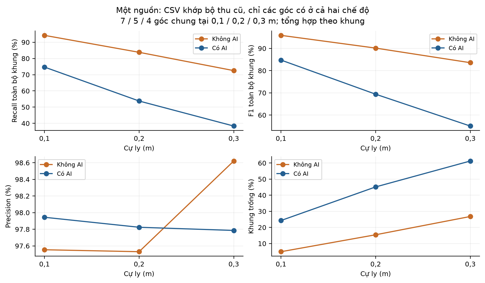
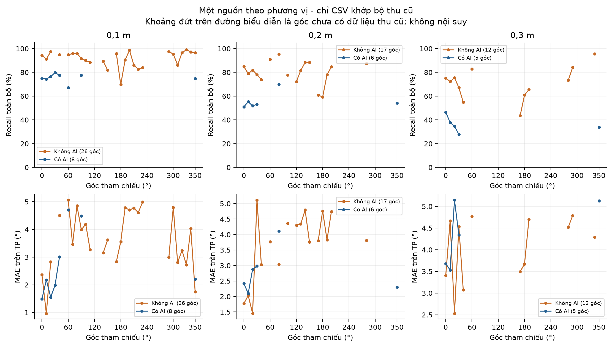
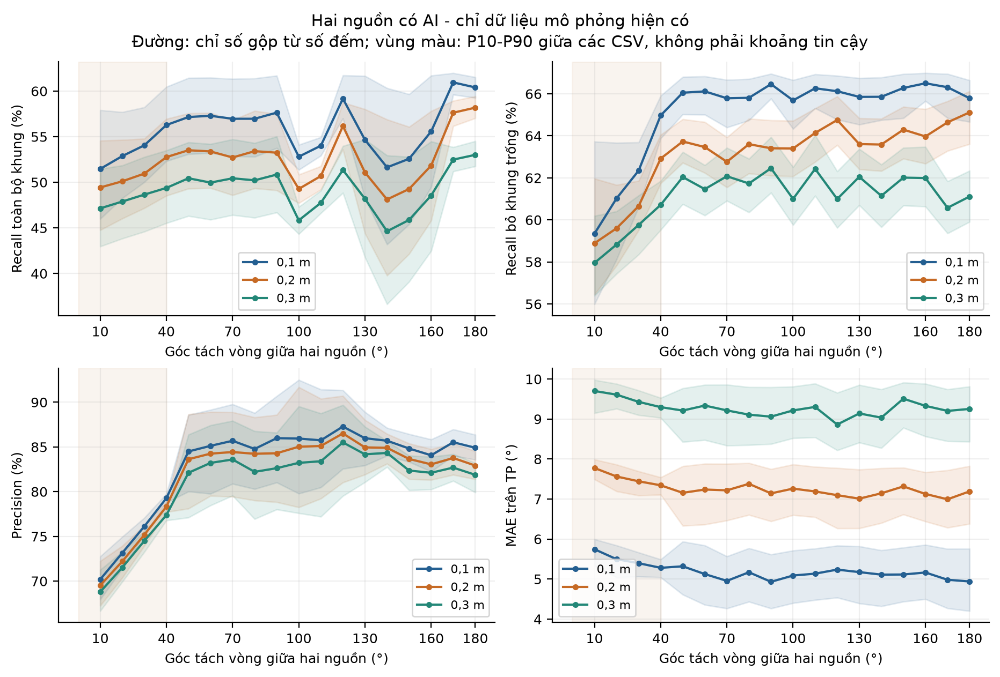

# Đánh giá dữ liệu DOA và đề xuất bổ sung báo cáo NCKH

Ngày đánh giá: 12/10/2026. Đối chiếu bản `Báo cáo NCKH.pdf` gồm 57 trang; chương 5 nằm ở trang PDF 50-56 (trang in 43-49).

Đã đọc lại **7.987 CSV**, gồm **148 tệp khớp bộ thu cũ** và **7.839 tệp mô phỏng**. Không sửa CSV đầu vào. Không có lỗi cấu trúc; 32 tệp đại diện được đối chiếu với bộ tính chỉ số đang dùng để đo.

## 1. Phạm vi và nguồn dữ liệu

| Thư mục | CSV hiện có | Khớp bộ thu cũ | Mô phỏng |
|---|---|---|---|
| 0sourceAI | 0 | 0 | 0 |
| 0sourceNOAI | 0 | 0 | 0 |
| 1sourceAI | 205 | 41 | 164 |
| 1sourceNOAI | 222 | 95 | 127 |
| 2sourceAI | 7.560 | 12 | 7.548 |
| 2sourceNOAI | 0 | 0 | 0 |
| 3sourceAI | 0 | 0 | 0 |
| 3sourceNOAI | 0 | 0 | 0 |

Tổng khung: 14.343.000; bộ thu cũ 232.800 khung, mô phỏng 14.110.200 khung. ZIP, bản sao lưu và các thư mục `_reports`, `_processed`, `_subsets`, `_synthetic` không được cộng lại vào tổng CSV đang dùng. Lịch sử trong các thư mục này chỉ được dùng đối chiếu nguồn.

“Khớp bộ thu cũ” nghĩa là nội dung hiện tại có SHA-256 trùng bản ghi thu cũ trong nhật ký; không phải xác minh độc lập rằng phiên đó đã thực hiện đúng mọi điều kiện vật lý. Không suy ra nguồn thật từ tên thư mục.

## 2. Quy tắc tính chỉ số

Các bản ghi DOA hiện có được đánh giá bằng quy tắc ghép một-một theo sai số góc vòng, với dung sai 15°. Phương án ghép ưu tiên số cặp đúng lớn nhất, sau đó tối thiểu hóa tổng sai số. Precision, Recall và F1 được tính từ tổng số TP, FP và FN, trong đó khung không có đầu ra vẫn đóng góp FN khi giả thiết nguồn tham chiếu đang hoạt động. MAE chỉ được tính trên các cặp TP. Ngoài kết quả trên toàn bộ khung, nghiên cứu báo cáo thêm Recall và F1 có điều kiện trên các khung có ít nhất một hướng được xuất, đồng thời công bố tỷ lệ khung trống. Do CSV không lưu trạng thái phát âm của từng nguồn, việc xem mọi nguồn khai báo là hoạt động liên tục là giả thiết đánh giá; cần nhãn hoạt động để phân biệt khoảng nghỉ của nội dung âm thanh với bỏ sót của hệ thống.

- P = TP/(TP+FP); R toàn bộ = TP/(số nguồn × tổng khung).
- R bỏ trống = TP/(số nguồn × số khung có đầu ra). Khung có hướng sai vẫn được giữ trong mẫu số.
- F1 toàn bộ = 2TP/(TP+FP+số nguồn × tổng khung); F1 bỏ trống thay tổng khung bằng số khung có đầu ra.
- MAE TP = tổng sai số của các cặp ghép đúng/TP; không dùng trung bình trực tiếp cột `mean_error`.
- Tỷ lệ phát hiện đủ nguồn = số khung ghép đúng mọi nguồn/số khung đánh giá. Đúng số hướng không đồng nghĩa đúng mọi nguồn.
- Chỉ số gộp được tính từ số đếm gộp. Trung bình ngang nhau theo góc, nếu dùng, được ghi riêng là phép phân tích độ nhạy.

## 3. CSV khớp bộ thu cũ: số liệu mô tả theo cự ly

P, R và F1 ở bảng sau tính trên toàn bộ khung. Mỗi hàng sử dụng mọi góc có trong tập con tương ứng; hai chế độ chưa dùng cùng tập góc. Không đọc chênh lệch giữa các hàng như tác động nhân quả của AI.

| Chế độ | Nguồn | r (m) | CSV | MAE (°) | P (%) | R (%) | F1 (%) |
|---|---|---|---|---|---|---|---|
| Không AI | 1 | 0,1 | 43 | 3,63 | 93,84 | 88,41 | 91,04 |
| Không AI | 1 | 0,2 | 31 | 3,83 | 93,78 | 76,43 | 84,22 |
| Không AI | 1 | 0,3 | 21 | 4,08 | 90,14 | 69,19 | 78,29 |
| Có AI | 1 | 0,1 | 10 | 2,51 | 98,09 | 75,21 | 85,14 |
| Có AI | 1 | 0,2 | 19 | 2,66 | 98,04 | 53,80 | 69,48 |
| Có AI | 1 | 0,3 | 12 | 4,23 | 97,94 | 36,82 | 53,52 |
| Có AI | 2 | 0,1 | 12 | 6,17 | 80,70 | 52,18 | 63,38 |

| Chế độ | Nguồn | r (m) | Trống (%) | R bỏ trống (%) | F1 bỏ trống (%) |
|---|---|---|---|---|---|
| Không AI | 1 | 0,1 | 8,99 | 97,15 | 95,46 |
| Không AI | 1 | 0,2 | 21,94 | 97,91 | 95,80 |
| Không AI | 1 | 0,3 | 28,44 | 96,69 | 93,30 |
| Có AI | 1 | 0,1 | 23,83 | 98,74 | 98,41 |
| Có AI | 1 | 0,2 | 45,24 | 98,24 | 98,14 |
| Có AI | 1 | 0,3 | 62,75 | 98,86 | 98,40 |
| Có AI | 2 | 0,1 | 14,10 | 60,75 | 69,32 |

Trên các CSV khớp bộ thu cũ của một nguồn có AI, Recall toàn bộ khung tại 0,1; 0,2 và 0,3 m lần lượt là 75,21%; 53,80% và 36,82%, trong khi Recall bỏ khung trống tương ứng là 98,74%; 98,24% và 98,86%. Tỷ lệ khung trống tăng từ 23,83% lên 45,24% và 62,75%. Chênh lệch lớn giữa hai cách tính cho thấy chất lượng khi đã có hướng đầu ra và mức độ duy trì đầu ra theo thời gian là hai đặc tính cần được đánh giá riêng. Không thể quy nguyên nhân của khung trống cho AI hoặc nhiễu môi trường chỉ từ CSV góc. MAE trên TP tăng từ 2,51° lên 2,66° và 4,23°; các giá trị này không phản ánh những khung không phát hiện được nguồn.

Đối với hai nguồn có AI, 12 CSV khớp bộ thu cũ bao phủ 7 bố trí ở cự ly chung 0,1 m, với tổng cộng 21.600 khung. Precision đạt 80,70%, Recall toàn bộ khung đạt 52,18%, F1 đạt 63,38% và MAE trên TP đạt 6,17°. Recall bỏ khung trống là 60,75%; tỷ lệ khung ghép đúng đồng thời cả hai nguồn là 27,63% trên toàn bộ khung. Các bố trí này có góc tách 90-170°; chưa có CSV thu cũ cho góc tách không quá 40°, hai nguồn đối ngược 180°, hoặc hai nguồn tại 0,2-0,3 m. Vì vậy các trường hợp đó chưa có kết quả thực nghiệm trong bộ đang kiểm tra.

Riêng một nguồn Có AI gộp ba cự ly: P = 98,04%, R toàn bộ = 54,05%, R bỏ trống = 98,53%, F1 toàn bộ = 69,68%, F1 bỏ trống = 98,28%, MAE = 2,92°, khung trống = 45,14%.

## 4. Đối chứng một nguồn trên cùng tập góc

Bảng này phù hợp hơn để bổ sung các hàng một nguồn trong Bảng 5.2 và 5.3 nếu cập nhật chú thích về tập góc và số lần lặp. Chỉ dùng góc có bản ghi khớp bộ thu cũ ở cả hai chế độ; các bản ghi không đồng nhất về độ dài và số lần lặp.

| r (m) | Chế độ | Góc chung | CSV | MAE (°) | P (%) | R (%) | F1 (%) |
|---|---|---|---|---|---|---|---|
| 0,1 | Không AI | 7 | 14 | 2,98 | 97,55 | 94,25 | 95,87 |
| 0,1 | Có AI | 7 | 9 | 2,57 | 97,94 | 74,70 | 84,76 |
| 0,2 | Không AI | 5 | 11 | 2,67 | 97,53 | 83,80 | 90,15 |
| 0,2 | Có AI | 5 | 17 | 2,71 | 97,82 | 53,77 | 69,40 |
| 0,3 | Không AI | 4 | 10 | 3,75 | 98,62 | 72,51 | 83,58 |
| 0,3 | Có AI | 4 | 8 | 3,83 | 97,79 | 38,33 | 55,08 |

Các góc chung: 0,1 m = {0,10,20,40,60,90,350}°; 0,2 m = {0,10,20,30,80}°; 0,3 m = {0,10,20,30}°. Tổng khung Có AI/Không AI tương ứng: 16.200/13.200; 30.600/9.000; 14.400/7.200.

Bảng 5.2/5.3 nên công bố số góc, số CSV, số khung và điều kiện chưa được xác nhận. Nếu tiếp tục quy định cùng nội dung phát, mức âm, nền yên tĩnh và ít nhất ba lần lặp như bản PDF, cần nhật ký để kiểm chứng trước khi coi bảng là kết quả đối chứng hoàn chỉnh.

Đối chứng một nguồn được giới hạn ở các góc có CSV khớp bộ thu cũ trong cả hai chế độ: 7 góc tại 0,1 m, 5 góc tại 0,2 m và 4 góc tại 0,3 m. Recall gộp trên toàn bộ khung của chế độ Không AI là 94,25%; 83,80% và 72,51%, so với 74,70%; 53,77% và 38,33% ở chế độ Có AI. Đây là thống kê mô tả các bản ghi đã lưu. Số lần lặp, độ dài bản ghi và điều kiện phát chưa được ghép cặp đầy đủ; vì vậy chưa thể kết luận mức chênh lệch là tác động riêng của mạng MLP. Khi cho các góc trọng số ngang nhau, Precision của Có AI còn thấp hơn Không AI ở cả ba cự ly; bộ số liệu hiện có chưa chứng minh AI làm tăng Precision trong cùng điều kiện thực nghiệm.

Phân tích độ nhạy với mỗi góc trọng số ngang nhau:

| r (m) | Chế độ | P trung bình góc (%) | R trung bình góc (%) | F1 trung bình góc (%) |
|---|---|---|---|---|
| 0,1 | Không AI | 97,71 | 94,40 | 95,97 |
| 0,1 | Có AI | 97,46 | 74,65 | 84,50 |
| 0,2 | Không AI | 97,94 | 83,80 | 90,05 |
| 0,2 | Có AI | 96,88 | 56,21 | 70,74 |
| 0,3 | Không AI | 98,63 | 72,51 | 83,53 |
| 0,3 | Có AI | 96,63 | 36,70 | 52,87 |

## 5. Biểu đồ theo góc để bổ sung H15/Hình 5.2

Mỗi điểm được tính từ số đếm gộp của các CSV khớp bộ thu cũ ở góc đó. Khoảng hở biểu thị chưa có dữ liệu thu cũ. Không đưa mô phỏng vào đường kết quả thu cũ. Đồ thị thiếu nhật ký xác nhận loại âm và điều kiện nền nên chú thích phải nêu phạm vi này. H16/Hình 5.3 mới có thể thể hiện đối chứng một nguồn; chưa đủ dữ liệu đối chứng hai/ba nguồn.

## 6. Kết quả mô phỏng, trình bày riêng

| Chế độ | Nguồn | r (m) | CSV | MAE (°) | P (%) | R toàn bộ (%) | F1 toàn bộ (%) |
|---|---|---|---|---|---|---|---|
| Không AI | 1 | 0,1 | 21 | 4,09 | 85,80 | 93,02 | 89,26 |
| Không AI | 1 | 0,2 | 35 | 3,66 | 81,89 | 91,87 | 86,59 |
| Không AI | 1 | 0,3 | 71 | 3,84 | 76,88 | 92,71 | 84,06 |
| Có AI | 1 | 0,1 | 49 | 3,83 | 82,50 | 91,60 | 86,82 |
| Có AI | 1 | 0,2 | 51 | 3,70 | 88,43 | 92,31 | 90,33 |
| Có AI | 1 | 0,3 | 64 | 3,87 | 84,24 | 92,47 | 88,16 |
| Có AI | 2 | 0,1 | 2.508 | 5,19 | 82,78 | 55,55 | 66,48 |
| Có AI | 2 | 0,2 | 2.520 | 7,25 | 81,75 | 52,15 | 63,68 |
| Có AI | 2 | 0,3 | 2.520 | 9,27 | 80,59 | 48,92 | 60,89 |

| Hai nguồn AI: r (m) | R bỏ trống (%) | F1 bỏ trống (%) | Khung trống (%) |
|---|---|---|---|
| 0,1 | 65,11 | 72,89 | 14,68 |
| 0,2 | 63,08 | 71,21 | 17,33 |
| 0,3 | 61,12 | 69,52 | 19,95 |

Phần mô phỏng hai nguồn có AI gồm 7.548 CSV và được phân tích riêng. Tại 0,1; 0,2 và 0,3 m, Recall bỏ khung trống lần lượt là 65,11%; 63,08% và 61,12%, còn MAE trên TP là 5,19°; 7,25° và 9,27°. Các cặp nguồn có góc tách nhỏ thể hiện Precision và Recall thấp hơn, đồng thời MAE cao hơn. Ví dụ tại 0,1 m, góc tách 10° có Precision 70,19%, Recall bỏ trống 59,35% và MAE 5,75°, còn ở 40° các giá trị là 79,27%, 64,97% và 5,28°. Đây là đặc tính của kịch bản sinh dữ liệu đã đặt, dùng khảo sát cách tổng hợp và biểu diễn chỉ số; chưa phải kiểm chứng hiệu năng thu bằng mạch ở các bố trí đó.

Mô phỏng một nguồn không có khung trống, khác rõ tập CSV thu cũ; do đó R toàn bộ và R bỏ trống bằng nhau trong tập mô phỏng này. Không dùng các bản ghi đó để suy luận tỷ lệ khung trống hoặc tác động của AI trong phần thu bằng mạch.

Vùng màu là phân vị P10-P90 giữa các CSV, không phải khoảng tin cậy. Quy luật khoảng cách và góc gần của bộ mô phỏng là giả thiết đã đặt trong quá trình sinh/chỉnh dữ liệu. Bộ thu cũ hai nguồn chưa phủ những vùng này.

## 7. Tổng hợp toàn bộ CSV hiện tại: phụ lục quản lý dữ liệu

| Thư mục | CSV | MAE (°) | P (%) | R toàn bộ (%) | R bỏ trống (%) | F1 toàn bộ (%) |
|---|---|---|---|---|---|---|
| 1sourceNOAI | 222 | 3,81 | 83,79 | 88,09 | 94,12 | 85,89 |
| 1sourceAI | 205 | 3,69 | 86,44 | 84,54 | 92,93 | 85,48 |
| 2sourceAI | 7.560 | 7,15 | 81,74 | 52,20 | 63,14 | 63,71 |

Các hàng này trộn CSV thu cũ và mô phỏng; chỉ mô tả thư mục hiện tại, không đưa nguyên hàng vào bảng kết quả thực nghiệm. Một nguồn Có AI có 164/205 CSV mô phỏng; Không AI có 127/222; hai nguồn Có AI có 7.548/7.560.

## 8. Nội dung nào có thể điền vào báo cáo

| 5.1; Bảng 5.1 | Điền mô tả bộ hiện có | Ba cự ly 0,1-0,3 m; lưới góc 10° cho bộ hoàn thiện. Phân biệt kế hoạch với dữ liệu đã có. |
|---|---|---|
| 5.2.1; Bảng 5.2 | Có số liệu một nguồn | Ba hàng 0,1/0,2/0,3 m. Dùng tập góc chung khi đối chứng; chưa có hai/ba nguồn Không AI hoặc 0,4 m. |
| 5.2.2; Bảng 5.3 | Có một nguồn và hai nguồn 0,1 m | Hai nguồn khớp bộ thu cũ chỉ có 12 CSV, 7 bố trí. Hai nguồn 0,2-0,3 m là mô phỏng; ba nguồn chưa có. |
| 5.2.3; H15/Hình 5.2 | Có thể vẽ một phần | Đã xuất biểu đồ một nguồn theo góc. Chỉ đánh dấu góc đã có CSV thu cũ, để hở góc chưa có. |
| H16/Hình 5.3 | Có phần một nguồn | Có F1 theo cự ly cho một nguồn; thiếu đối chứng hai/ba nguồn. Mô phỏng hai nguồn phải tách riêng. |
| 5.3; Bảng 5.4, 5.5; H17 | Chưa đủ | CSV không ghi loại âm, KEEP/NOISE, vị trí nhiễu, SNR hoặc hoạt động từng nguồn; 0source trống. |
| 4.8.1: chỉ số MLP | Không lấy từ DOA CSV | Cần y_true/y_pred hoặc điểm KEEP, nhãn âm và tập test. TP/FP góc không phải confusion matrix nhị phân. |
| 5.4.1; Bảng 5.6 | Đã có trong PDF, không suy ra từ data | Đối chiếu build log và linker map nếu xác minh; dữ liệu góc không xác định Flash/SRAM. |
| 5.4.2; Bảng 5.7 | Chưa đủ | Không có timestamp xử lý, DOA/AI/TOTAL, bộ đếm DMA hoặc nhãn thời điểm nguồn bật/tắt. |
| 5.5; Bảng 5.8 | Chưa đủ | Không có điện áp/dòng theo thời gian. 355 mW trong PDF chưa gắn chắc chắn với chế độ đo. |
| 5.6: thảo luận | Có thể bổ sung | Nêu khung trống, MAE có điều kiện, thiếu đối chứng, bộ dữ liệu đã lọc và các xu hướng mô phỏng. |

### Điểm cần chỉnh để bản mô tả khớp bộ dữ liệu đang có

- Bản PDF dự kiến 1.000 khung và ít nhất ba lần lặp; bộ hiện tại chứa 600 hoặc 1.800 khung/CSV, số lần lặp không đều. 28 CSV một nguồn Không AI có 600 khung; các CSV khác đều có 1.800 khung.
- Lưới một nguồn hiện tại là 10°, không chỉ 30°. 36 góc đủ trong thư mục chính nhờ mô phỏng; bộ thu cũ riêng chưa đủ 36 góc ở cả hai chế độ.
- Hai nguồn có 3.780 cấu hình theo thứ tự khai báo, hoặc 1.890 cấu hình hình học không phân biệt thứ tự. Hai CSV cho mỗi cấu hình có thứ tự không tương đương hai lần thu độc lập cho mỗi bố trí vật lý.
- Bộ thu cũ hai nguồn chỉ có cự ly 0,1 m, góc tách 90,100,110,120,160,170°. Góc tách ≤40° và 180° chỉ có dữ liệu mô phỏng trong bộ đang xét; cặp (0°,45°) dự kiến cũng chưa có.
- Chưa có 0,4 m, hai nguồn Không AI, ba nguồn hoặc bản ghi không nguồn KEEP.
- Lịch sử có thao tác loại các tệp có R bỏ trống, P hoặc F1 bỏ trống dưới 55%; phần thu cũ còn lại là tập đã chọn lọc. Nếu đánh giá hiệu năng chung, cần cả các phiên bị loại hoặc mô tả rõ điều kiện chọn mẫu.
- Không dùng P/R/F1 ghép góc để điền chỉ số phân loại nhị phân KEEP/NOISE; không dùng CSV không có thời gian để suy ra độ trễ hay công suất.

## 9. Các đoạn văn đề xuất để bổ sung

### Bổ sung phương pháp ở 5.1.2

Các bản ghi DOA hiện có được đánh giá bằng quy tắc ghép một-một theo sai số góc vòng, với dung sai 15°. Phương án ghép ưu tiên số cặp đúng lớn nhất, sau đó tối thiểu hóa tổng sai số. Precision, Recall và F1 được tính từ tổng số TP, FP và FN, trong đó khung không có đầu ra vẫn đóng góp FN khi giả thiết nguồn tham chiếu đang hoạt động. MAE chỉ được tính trên các cặp TP. Ngoài kết quả trên toàn bộ khung, nghiên cứu báo cáo thêm Recall và F1 có điều kiện trên các khung có ít nhất một hướng được xuất, đồng thời công bố tỷ lệ khung trống. Do CSV không lưu trạng thái phát âm của từng nguồn, việc xem mọi nguồn khai báo là hoạt động liên tục là giả thiết đánh giá; cần nhãn hoạt động để phân biệt khoảng nghỉ của nội dung âm thanh với bỏ sót của hệ thống.

### Bổ sung kết quả một nguồn ở 5.2.2 và thảo luận 5.6

Trên các CSV khớp bộ thu cũ của một nguồn có AI, Recall toàn bộ khung tại 0,1; 0,2 và 0,3 m lần lượt là 75,21%; 53,80% và 36,82%, trong khi Recall bỏ khung trống tương ứng là 98,74%; 98,24% và 98,86%. Tỷ lệ khung trống tăng từ 23,83% lên 45,24% và 62,75%. Chênh lệch lớn giữa hai cách tính cho thấy chất lượng khi đã có hướng đầu ra và mức độ duy trì đầu ra theo thời gian là hai đặc tính cần được đánh giá riêng. Không thể quy nguyên nhân của khung trống cho AI hoặc nhiễu môi trường chỉ từ CSV góc. MAE trên TP tăng từ 2,51° lên 2,66° và 4,23°; các giá trị này không phản ánh những khung không phát hiện được nguồn.

### Bổ sung đối chứng ở 5.2.3

Đối chứng một nguồn được giới hạn ở các góc có CSV khớp bộ thu cũ trong cả hai chế độ: 7 góc tại 0,1 m, 5 góc tại 0,2 m và 4 góc tại 0,3 m. Recall gộp trên toàn bộ khung của chế độ Không AI là 94,25%; 83,80% và 72,51%, so với 74,70%; 53,77% và 38,33% ở chế độ Có AI. Đây là thống kê mô tả các bản ghi đã lưu. Số lần lặp, độ dài bản ghi và điều kiện phát chưa được ghép cặp đầy đủ; vì vậy chưa thể kết luận mức chênh lệch là tác động riêng của mạng MLP. Khi cho các góc trọng số ngang nhau, Precision của Có AI còn thấp hơn Không AI ở cả ba cự ly; bộ số liệu hiện có chưa chứng minh AI làm tăng Precision trong cùng điều kiện thực nghiệm.

### Bổ sung kết quả hai nguồn thu cũ ở 5.2.2

Đối với hai nguồn có AI, 12 CSV khớp bộ thu cũ bao phủ 7 bố trí ở cự ly chung 0,1 m, với tổng cộng 21.600 khung. Precision đạt 80,70%, Recall toàn bộ khung đạt 52,18%, F1 đạt 63,38% và MAE trên TP đạt 6,17°. Recall bỏ khung trống là 60,75%; tỷ lệ khung ghép đúng đồng thời cả hai nguồn là 27,63% trên toàn bộ khung. Các bố trí này có góc tách 90-170°; chưa có CSV thu cũ cho góc tách không quá 40°, hai nguồn đối ngược 180°, hoặc hai nguồn tại 0,2-0,3 m. Vì vậy các trường hợp đó chưa có kết quả thực nghiệm trong bộ đang kiểm tra.

### Mục riêng: khảo sát mô phỏng

Phần mô phỏng hai nguồn có AI gồm 7.548 CSV và được phân tích riêng. Tại 0,1; 0,2 và 0,3 m, Recall bỏ khung trống lần lượt là 65,11%; 63,08% và 61,12%, còn MAE trên TP là 5,19°; 7,25° và 9,27°. Các cặp nguồn có góc tách nhỏ thể hiện Precision và Recall thấp hơn, đồng thời MAE cao hơn. Ví dụ tại 0,1 m, góc tách 10° có Precision 70,19%, Recall bỏ trống 59,35% và MAE 5,75°, còn ở 40° các giá trị là 79,27%, 64,97% và 5,28°. Đây là đặc tính của kịch bản sinh dữ liệu đã đặt, dùng khảo sát cách tổng hợp và biểu diễn chỉ số; chưa phải kiểm chứng hiệu năng thu bằng mạch ở các bố trí đó.

## 10. Nguồn và khả năng đối chiếu

- Báo cáo được đọc: `../Báo cáo NCKH.pdf`; SHA-256: `4882618eca669b6610ebdf3ce5a5df87adbdb3f93cd90b6b22c2c1b147d77a24`.
- `ket_qua_danh_gia.json`: tổng hợp, từng cấu hình góc, quy tắc tính, danh sách kiểm tra và nguồn đối chiếu.
- `doi_chieu_nguon_tung_csv.json`: đường dẫn tương đối, SHA-256, nguồn và số đếm/chỉ số của từng CSV.
- Nhật ký nguồn gốc gồm `data/_data_sources.json`, kế hoạch cập nhật dữ liệu và các manifest lịch sử. Đối chiếu bằng SHA-256; không gán nguồn từ tên file.
- Biểu đồ có cả PNG và SVG trong `figures/`; số liệu chỉ đọc từ lần đánh giá hiện tại.
- Không bổ sung số liệu cho các mục thiếu. Không sửa dữ liệu gốc hoặc bản PDF báo cáo ban đầu.
