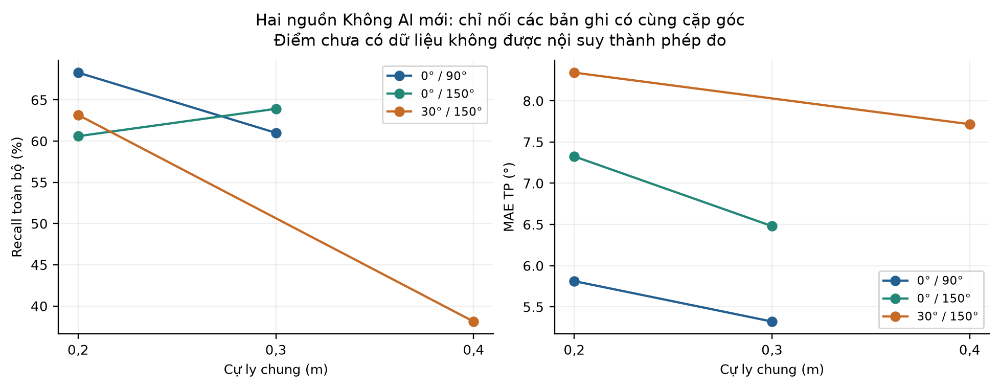
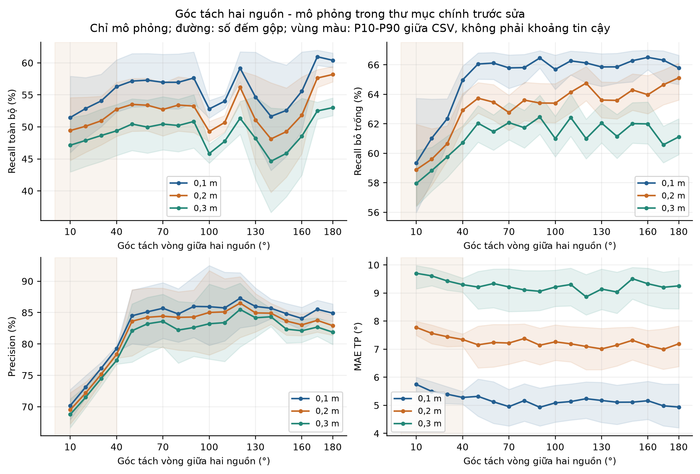
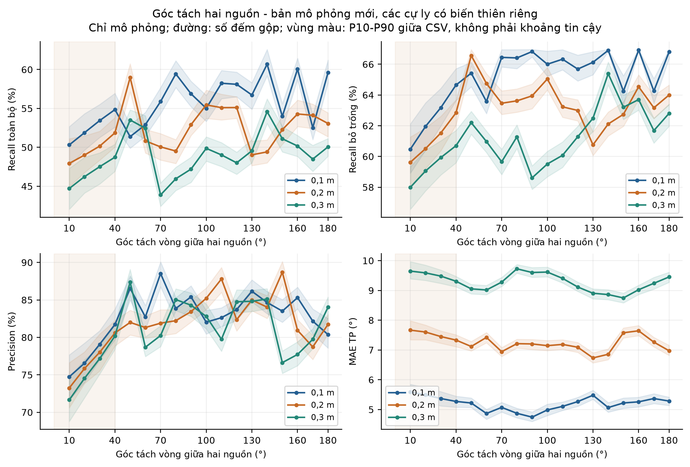

# Đánh giá cập nhật sau khi thêm hai nguồn Không AI

Chốt bản đánh giá: 12/10/2026 21:22:18 (UTC+7). Bản này bổ sung bộ CSV mới và thay hình mô phỏng góc tách bằng bản mô phỏng riêng có các cự ly biến thiên độc lập. Tệp thêm sau mốc chốt chưa nằm trong bản số liệu này. PDF NCKH ban đầu và CSV chính giữ nguyên.

Đã kiểm tra 8.061 CSV chính, không có lỗi cấu trúc. Có 148 tệp khớp bản ghi thu cũ, 7.839 mô phỏng, 59 CSV hai nguồn Không AI mới do người dùng khai báo thu và 15 CSV một nguồn Có AI ở 0,4 m mới xuất hiện trong lần kiểm tra. 40 tệp đại diện được đối chiếu số đếm với bộ ghép nguồn đang dùng.

## 1. Dữ liệu mới

| Thư mục | CSV | Khớp thu cũ | Mô phỏng | Mới chưa đối chiếu |
|---|---|---|---|---|
| 1sourceAI | 220 | 41 | 164 | 15 |
| 1sourceNOAI | 222 | 95 | 127 | 0 |
| 2sourceAI | 7.560 | 12 | 7.548 | 0 |
| 2sourceNOAI | 59 | 0 | 0 | 59 |

| r (m) | CSV | Khung | Cặp góc | MAE (°) | P (%) | R (%) | F1 (%) |
|---|---|---|---|---|---|---|---|
| 0,2 | 36 | 3.600 | 7 | 6,48 | 92,64 | 64,33 | 75,93 |
| 0,3 | 12 | 1.200 | 2 | 5,91 | 93,63 | 62,46 | 74,93 |
| 0,4 | 11 | 1.100 | 2 | 7,75 | 58,53 | 36,95 | 45,31 |

| r (m) | R bỏ trống (%) | F1 bỏ trống (%) | Trống (%) | Đủ hai nguồn (%) |
|---|---|---|---|---|
| 0,2 | 66,59 | 77,48 | 3,39 | 36,50 |
| 0,3 | 62,88 | 75,23 | 0,67 | 28,42 |
| 0,4 | 38,39 | 46,36 | 3,73 | 8,55 |

P/R/F1 trong bảng đầu dùng toàn bộ khung, ghép một-một theo sai số vòng ≤15°, MAE chỉ trên TP. R và F1 bỏ trống là chỉ số có điều kiện theo khung có ít nhất một hướng. Mọi nguồn khai báo được giả thiết hoạt động trong mọi khung. CSV không có nhãn hoạt động hoặc loại âm nên chưa phân biệt được khoảng nghỉ và bỏ sót.

59 CSV mới nằm trực tiếp trong `data/2sourceNOAI`, không có nhánh cự ly. Khoảng cách đọc từ `distance_cm`, không suy từ số lượt ở tên tệp. Thứ tự 11 cột khác chương trình thu hiện tại; đã đọc theo tên cột, không sửa file.

Tại 0,2 m có 8 cấu hình theo thứ tự khai báo, tương ứng 7 cặp góc không phân biệt thứ tự. Cặp 180°/330° và 330°/180° được gộp khi phân tích hình học. Không tìm thấy chuỗi raw_angles trùng hoàn toàn trong cùng cặp góc và cự ly giữa các tệp mới.

## 2. Bảng 5.2 đề xuất: Không AI

| Nguồn | r (m) | MAE (°) | P (%) | R (%) | F1 (%) |
|---|---|---|---|---|---|
| 1 | 0,1 | 2,98 | 97,55 | 94,25 | 95,87 |
| 1 | 0,2 | 2,67 | 97,53 | 83,80 | 90,15 |
| 1 | 0,3 | 3,75 | 98,62 | 72,51 | 83,58 |
| 1 | 0,4 | – | – | – | – |
| 2 | 0,1 | – | – | – | – |
| 2 | 0,2 | 6,48 | 92,64 | 64,33 | 75,93 |
| 2 | 0,3 | 5,91 | 93,63 | 62,46 | 74,93 |
| 2 | 0,4 | 7,75 | 58,53 | 36,95 | 45,31 |
| 3 | 0,1 | – | – | – | – |
| 3 | 0,2 | – | – | – | – |
| 3 | 0,3 | – | – | – | – |
| 3 | 0,4 | – | – | – | – |

Có số liệu cho 6/12 hàng. Các hàng một nguồn dùng các góc thu cũ chung giữa AI và Không AI (7/5/4 góc ở 0,1/0,2/0,3 m); các hàng hai nguồn dùng bộ mới. Các hàng “–” chưa có bản ghi phù hợp.

## 3. Bảng 5.3 đề xuất: Có AI

| Nguồn | r (m) | MAE (°) | P (%) | R (%) | F1 (%) |
|---|---|---|---|---|---|
| 1 | 0,1 | 2,57 | 97,94 | 74,70 | 84,76 |
| 1 | 0,2 | 2,71 | 97,82 | 53,77 | 69,40 |
| 1 | 0,3 | 3,83 | 97,79 | 38,33 | 55,08 |
| 1 | 0,4 | 5,46 | 61,41 | 27,00 | 37,51 |
| 2 | 0,1 | 6,17 | 80,70 | 52,18 | 63,38 |
| 2 | 0,2 | – | – | – | – |
| 2 | 0,3 | – | – | – | – |
| 2 | 0,4 | – | – | – | – |
| 3 | 0,1 | – | – | – | – |
| 3 | 0,2 | – | – | – | – |
| 3 | 0,3 | – | – | – | – |
| 3 | 0,4 | – | – | – | – |

Có số liệu bản ghi cho 5/12 hàng. Một nguồn Có AI ở 0,4 m dùng 15 CSV mới, tổng 3.000 khung, 3 góc; chưa đối chiếu nguồn lịch sử. Hai nguồn Có AI tại 0,2-0,3 m trong data hiện là mô phỏng, không điền vào hàng thực nghiệm này. Nguồn của CSV thu cũ được đối chiếu theo SHA-256; các bộ mới chưa có kiểm chứng độc lập điều kiện vật lý.

Chưa có đối chứng thu bằng mạch hai nguồn AI/Không AI ở cùng cự ly: Có AI thu cũ chỉ 0,1 m, Không AI mới chỉ 0,2-0,4 m. Không dùng khác biệt giữa các hàng khác cự ly làm tác động của AI.

## 4. Hai nguồn Không AI theo từng cặp góc

| r (m) | Góc nguồn (°) | CSV | P (%) | R (%) | F1 (%) | MAE (°) |
|---|---|---|---|---|---|---|
| 0,2 | 0/150 | 5 | 86,94 | 60,60 | 71,42 | 7,33 |
| 0,2 | 0/230 | 6 | 96,02 | 66,33 | 78,46 | 5,53 |
| 0,2 | 0/90 | 5 | 97,16 | 68,30 | 80,21 | 5,81 |
| 0,2 | 180/330 | 8 | 93,39 | 64,50 | 76,30 | 7,49 |
| 0,2 | 30/150 | 6 | 89,70 | 63,17 | 74,13 | 8,34 |
| 0,2 | 30/180 | 5 | 99,29 | 69,70 | 81,90 | 4,07 |
| 0,2 | 30/90 | 1 | 50,42 | 30,00 | 37,62 | 5,13 |
| 0,3 | 0/150 | 6 | 94,46 | 63,92 | 76,24 | 6,48 |
| 0,3 | 0/90 | 6 | 92,78 | 61,00 | 73,60 | 5,32 |
| 0,4 | 0/270 | 3 | 55,62 | 33,83 | 42,07 | 7,84 |
| 0,4 | 30/150 | 8 | 59,57 | 38,12 | 46,49 | 7,72 |

Mỗi CSV chỉ 100 khung, khác kế hoạch 1.000 khung và ít nhất ba lần lặp ở 5.1.2. Trường hợp (30°,90°) tại 0,2 m chỉ có một CSV; không đủ yêu cầu lặp. Các khung liên tiếp không được coi là 100 phép thử độc lập. Tỷ lệ phát hiện đồng thời đủ hai nguồn theo cự ly là 36,50%; 28,42%; 8,55%.

## 5. Vì sao phần mô phỏng góc tách có hình dạng giống nhau?

Hình dạng tương tự xuất phát chủ yếu từ việc giữ chung mẫu phân bố khung trống theo góc tách giữa ba cự ly. Trong bộ mô phỏng cũ, tương quan của các đường tỷ lệ khung trống là 0,9996-0,9998. Recall toàn bộ bằng Recall bỏ trống nhân tỷ lệ khung có đầu ra, nên nó thừa hưởng mẫu dao động chung này: tương quan 0,9538-0,9781. Precision cũng dùng gần cùng hình dạng suy hao theo góc và chủ yếu dịch mức giữa các cự ly, với tương quan 0,9945-0,9968. Một điểm góc tách được gộp từ nhiều CSV nên nhiễu riêng từng tệp bị trung bình hóa. Thay đổi nhỏ ở MAE hoặc tăng nhiễu ở từng CSV chưa xử lý được mẫu chung của đường gộp.

## 6. Bản mô phỏng sửa phân bố

Bản mô phỏng mới sinh các trường biến thiên riêng cho tỷ lệ khung trống, Recall, Precision và MAE theo từng cự ly, cặp góc và lượt. Mẫu vị trí khung trống được tạo lại trong bản mô phỏng riêng, thay vì giữ mẫu cũ. Seed cố định, không thử nhiều seed để lựa chọn biểu đồ. Tổng TP, FP, số khung trống và tổng sai số theo từng cự ly bằng bộ mô phỏng trước, nên các chỉ số gộp theo cự ly giữ nguyên; F1 theo từng góc/CSV được tính lại. Trong nhóm 10-40°, càng gần thì Recall/Precision giảm và MAE tăng. Thứ tự hiệu năng trung bình theo cự ly vẫn giữ, còn các cặp góc cụ thể có thể dao động và giao nhau. Đây là thay đổi giả thiết của mô phỏng, không phải phát hiện mới từ phép thu bằng mạch.

| Chỉ số | Trước: mọi góc | Sau: mọi góc | Trước: >40° | Sau: >40° |
|---|---|---|---|---|
| Recall toàn bộ | 0,963 | 0,207 | 0,977 | 0,247 |
| Recall bỏ trống | 0,884 | 0,426 | 0,336 | 0,143 |
| Precision | 0,996 | 0,609 | 0,881 | 0,119 |
| MAE TP | 0,716 | 0,171 | 0,163 | 0,269 |
| Khung trống | 1,000 | 0,285 | 1,000 | 0,327 |

Bảng tương quan dùng trung bình trị tuyệt đối Pearson của ba cặp cự ly. “Mọi góc” gồm 10-180°; “>40°” loại nhóm suy hao góc gần có quy luật vật lý chung. Tương quan chỉ mô tả độ giống hình dạng, không phải chỉ số hiệu năng hoặc kiểm định mô hình truyền âm.

| r (m) | P (%) | R toàn bộ (%) | R bỏ trống (%) | F1 toàn bộ (%) | MAE (°) |
|---|---|---|---|---|---|
| 0,1 | 82,78 | 55,55 | 65,11 | 66,48 | 5,19 |
| 0,2 | 81,75 | 52,15 | 63,08 | 63,68 | 7,25 |
| 0,3 | 80,59 | 48,92 | 61,12 | 60,89 | 9,27 |

Chỉ số gộp này thuộc riêng 7.548 CSV mô phỏng, không gồm 12 CSV thu cũ trong nhánh hai nguồn AI. Vùng màu trên đồ thị là P10-P90 giữa các CSV, không phải khoảng tin cậy. Đường vẫn có xu hướng suy hao chung ở góc gần vì giả thiết mô phỏng giữ hiệu ứng đó.

Bản mô phỏng mới: `../../data/_synthetic/two_source_ai_independent_separation_20261012_v1/`. CSV có 11 cột; nguồn, seed và SHA-256 được ghi trong DATASET_INFO.json. Chưa thay bản mô phỏng này vào data/2sourceAI.

## 7. Những phần có thể bổ sung và phần còn thiếu

| Bảng 5.2 | 6/12 hàng có số liệu | Một nguồn: 0,1-0,3 m; hai nguồn: 0,2-0,4 m. Chưa có một nguồn 0,4 m, hai nguồn 0,1 m hoặc ba nguồn. |
|---|---|---|
| Bảng 5.3 | 5/12 hàng có số liệu bản ghi | Một nguồn: 0,1-0,4 m; hàng 0,4 m vừa thêm, chưa đối chiếu nguồn lịch sử. Hai nguồn: 0,1 m. Hai nguồn 0,2-0,3 m trong thư mục chính là mô phỏng; các hàng khác thiếu. |
| 5.2.3; H15/H16 | Có thể bổ sung một phần | Một nguồn có đối chứng góc chung. Hai nguồn Không AI có dữ liệu theo cự ly, nhưng hai chế độ chưa có cự ly trùng ở phần thu cũ/mới. |
| Góc tách gần / đối ngược | Chưa có kiểm chứng thu | Bộ Không AI mới phủ 60-150°; Có AI thu cũ phủ 90-170°. ≤40° và 180° chỉ có mô phỏng. |
| 5.3; Bảng 5.4/5.5; H17 | Chưa đủ | Không có nhãn âm KEEP/NOISE, cấu hình nhiễu hoặc bản ghi không nguồn KEEP. |
| 5.4.2; Bảng 5.7 | Chưa đủ | Thiếu thời gian xử lý, thời điểm nguồn bật/tắt và số DMA bỏ lỡ. |
| 5.5; Bảng 5.8 | Chưa đủ | Thiếu chuỗi đo điện áp/dòng và chế độ tương ứng. |
| 5.6: thảo luận | Có thêm nội dung | Kết quả hai nguồn Không AI tại 0,4 m yếu, cặp góc giữa cự ly khác nhau và mẫu 100 khung/CSV. |

Bảng có số liệu không đồng nghĩa đã hoàn thành quy trình thực nghiệm trong PDF: cần nhật ký loại âm KEEP, nền, mức phát, phiên bản firmware, thời lượng và số lần lặp. Bộ thu cũ trước đây còn trải qua lọc tệp dưới 55%; cần công bố điều kiện chọn mẫu hoặc đánh giá lại cả các phiên bị loại nếu kết luận hiệu năng tổng thể. Không loại thêm tệp yếu trong lần đánh giá này.

## 8. Đoạn văn đề xuất cho 5.2.1 và 5.6

Bổ sung các bản ghi hai nguồn ở chế độ Không AI cho cự ly 0,2; 0,3 và 0,4 m. Bộ dữ liệu gồm 59 CSV, mỗi CSV chứa 100 khung, tổng cộng 5.900 khung. Tại ba cự ly, Precision lần lượt đạt 92,64%; 93,63% và 58,53%, Recall trên toàn bộ khung đạt 64,33%; 62,46% và 36,95%, F1 đạt 75,93%; 74,93% và 45,31%. MAE trên các cặp TP tương ứng là 6,48°; 5,91° và 7,75°. Tập cặp góc khác nhau giữa các cự ly, vì vậy MAE tại 0,3 m thấp hơn 0,2 m chưa đủ để kết luận khoảng cách lớn cải thiện sai số. Mỗi hàng là thống kê mô tả tập bản ghi đang có; cần mở rộng thời lượng và đối chứng cùng cặp góc, nội dung âm thanh, mức âm và cấu hình firmware trước khi đánh giá tổng quát.

## 9. Nguồn đối chiếu và kiểm tra

- PDF đối chiếu: `../Báo cáo NCKH.pdf`, SHA-256 `4882618eca669b6610ebdf3ce5a5df87adbdb3f93cd90b6b22c2c1b147d77a24`.
- `ket_qua_danh_gia.json`: tổng hợp số đếm, từng cặp góc, bản đồ nguồn và tương quan hình dạng.
- `doi_chieu_nguon_tung_csv.json`: SHA-256 và số đếm từng CSV chính.
- Nguồn mô phỏng riêng: DATASET_INFO.json và evaluation.json trong thư mục kịch bản mới.
- Công thức giữ như báo cáo: tối đa TP, tối thiểu sai số, dung sai 15°; tính chỉ số từ số đếm gộp.
