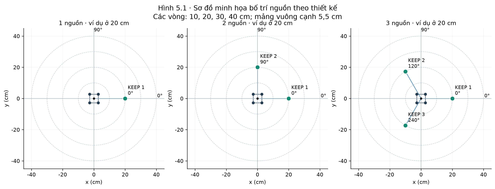
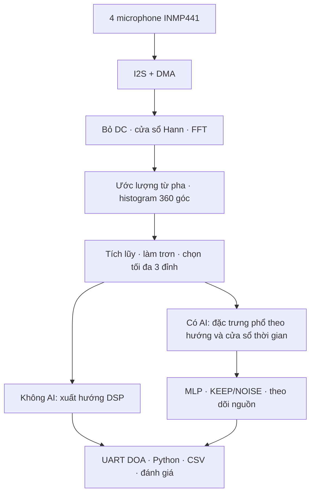
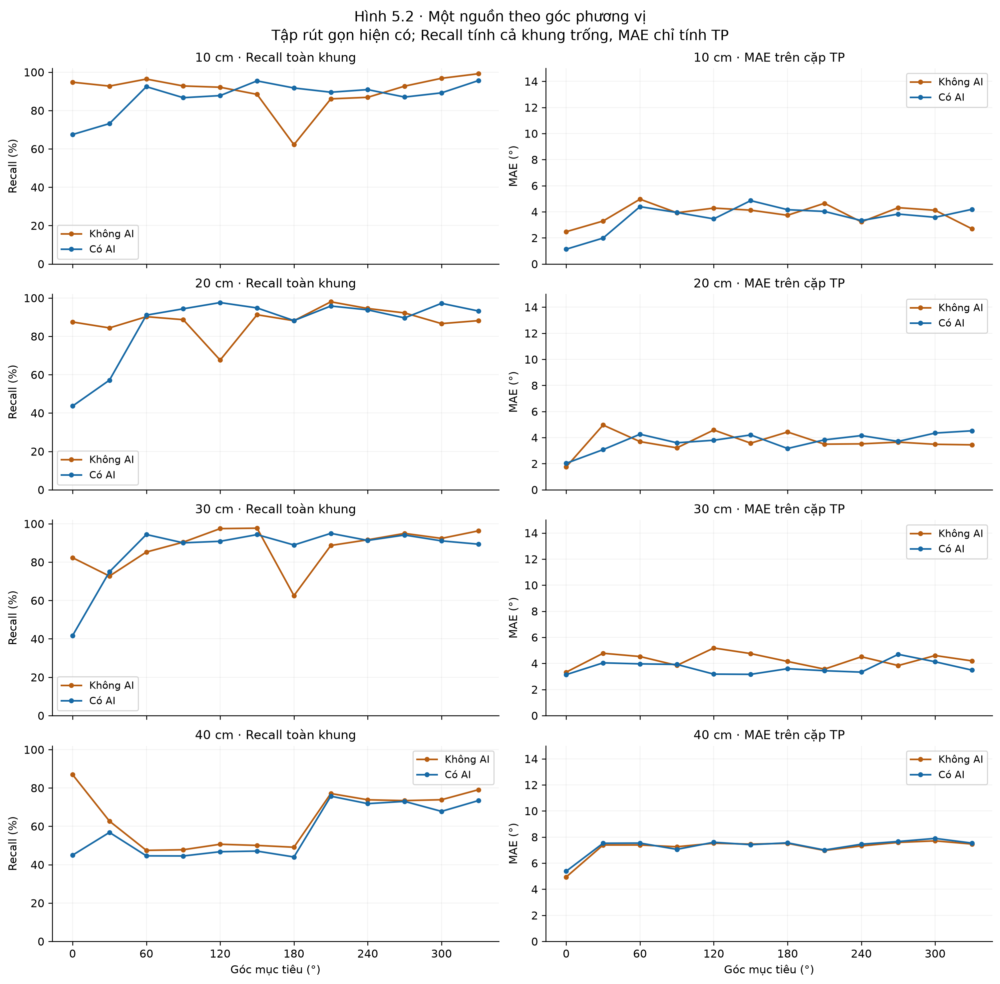
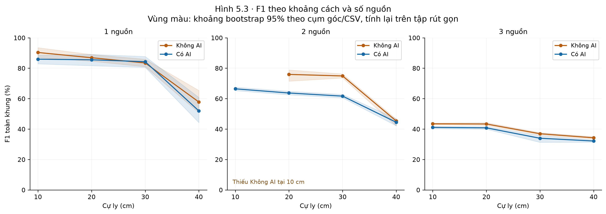
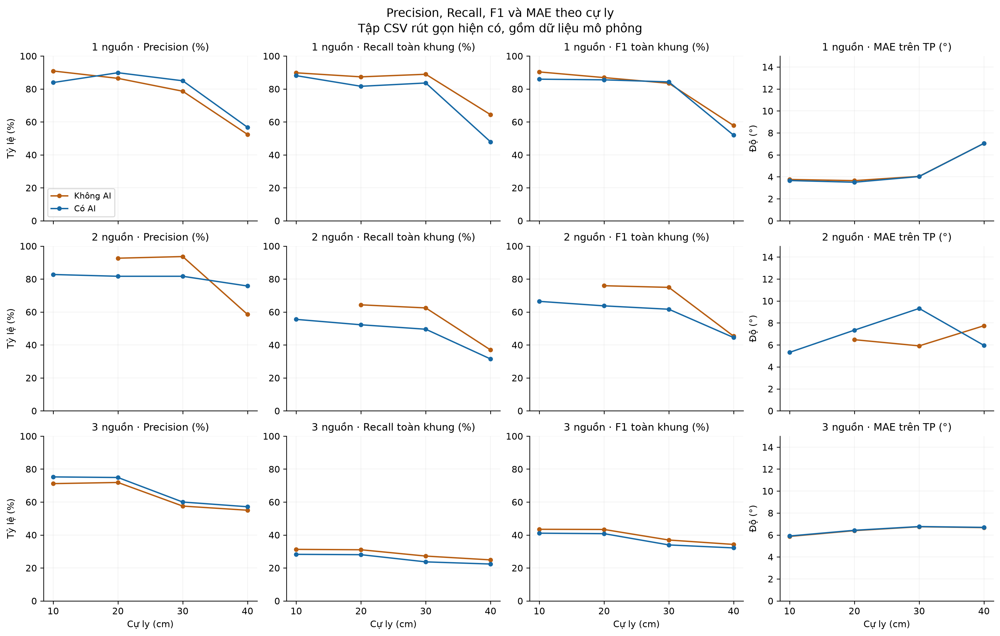
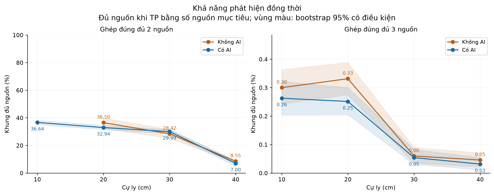
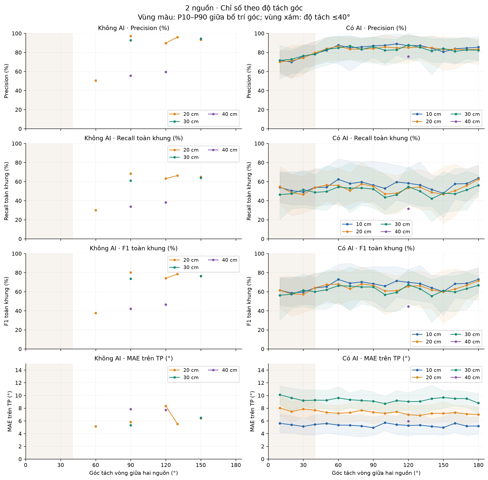
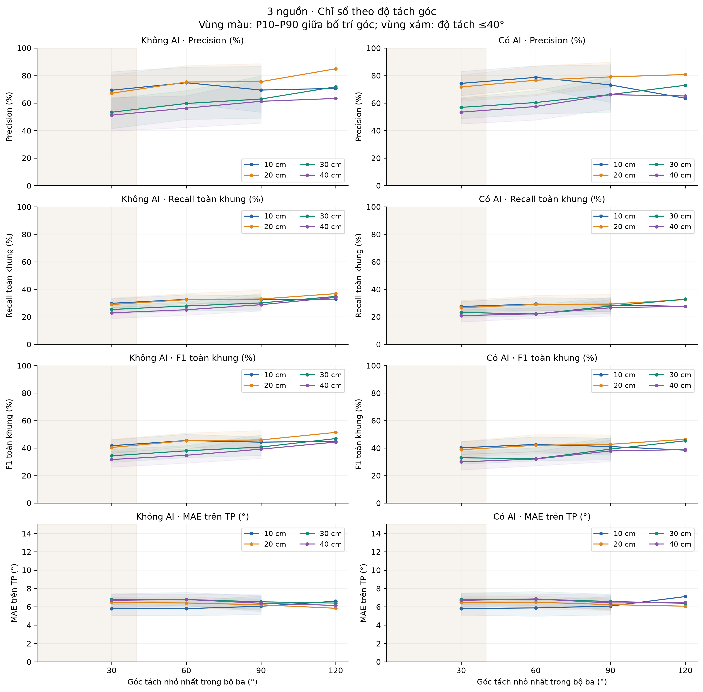
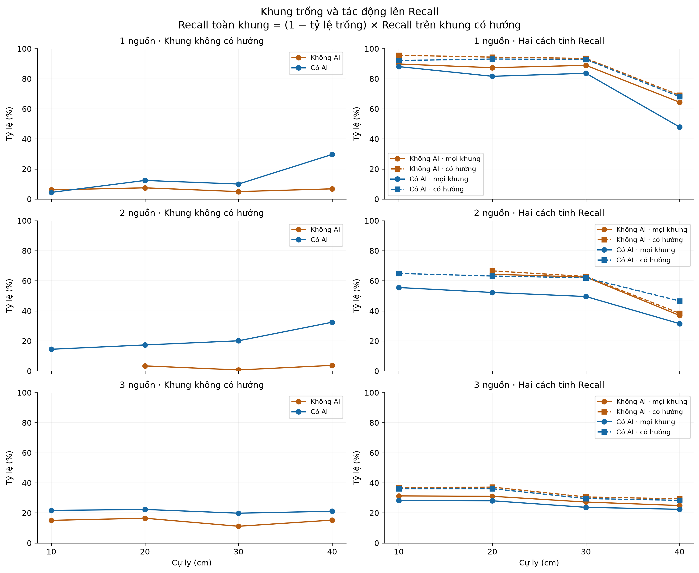
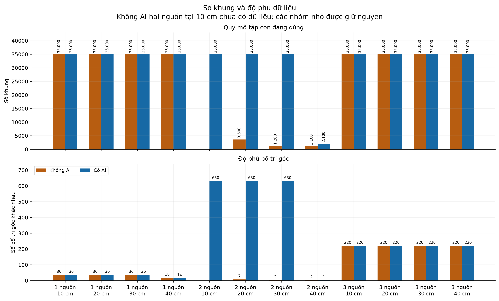

# NCKH 2026 — Định hướng nhiều nguồn âm trên STM32F4

Hệ thống dùng **4 microphone INMP441**, xử lý DSP trên **STM32F411CEU6**
để ước lượng hướng của tối đa **3 nguồn âm**, kết hợp bộ phân loại AI để
quyết định giữ hoặc loại các hướng phát hiện. Python nhận UART, hiển thị
radar, thu CSV và đánh giá theo khoảng cách **10, 20, 30, 40 cm**.

**Snapshot đang dùng:** 4.123 CSV, 673.000 khung; xử lý ngày 16/10/2026.
README tổng hợp ngày 18/10/2026. Tập hiện có gồm mô phỏng có hồ sơ, dữ liệu
khớp bản ghi thu cũ và dữ liệu chưa xác minh; kết quả bên dưới mô tả tập này,
chưa phải đối chứng phần cứng được kiểm soát hoàn toàn.

[Hướng dẫn Python](Python/README.md) · [Dữ liệu](data) ·
[Hồ sơ nguồn](data/_data_sources.json) ·
[Báo cáo NCKH PDF](Paper/B%C3%A1o%20c%C3%A1o%20NCKH.pdf) ·
[Tải bộ hình PNG/SVG](Paper/bieu_do_du_lieu_rut_gon_20261016/bieu_do_nckh.zip)

## Bố trí nguồn và kiến trúc xử lý

Các ví dụ dưới đây minh họa thiết kế với mảng vuông cạnh 5,5 cm, nguồn ở
cự ly 20 cm và các vòng tham chiếu 10–40 cm. Đây là sơ đồ thiết kế, không
phải ảnh hoặc nhật ký xác nhận bố trí đã thu.



[SVG để chỉnh sửa hoặc in](Paper/bieu_do_du_lieu_rut_gon_20261016/figures/H14.svg)

Sơ đồ dùng 0° theo +x và 90° theo +y. Radar Python hiện quy ước 0° bên trái,
90° phía dưới, 180° bên phải và 270° phía trên; cần đối chiếu hệ tọa độ khi
lắp đặt, không tự bù hoặc đảo góc trong CSV để giảm sai số.



AI xuất xác suất KEEP/NOISE để lọc hướng; mạng hiện tại không trực tiếp hồi
quy một góc mới. Mục tiêu ứng dụng là giữ giọng nói, hạn chế quạt và bàn phím.
Precision/recall định hướng trong README không thay thế các chỉ số phân loại
loại âm; CSV DOA không chứa đủ nhãn âm thanh để đánh giá riêng từng lớp.

### Cấu hình xác nhận từ mã nguồn

| Thành phần | Cấu hình hiện tại |
| --- | --- |
| Vi điều khiển | STM32F411CEU6; project Keil uVision |
| Thu âm | 4 kênh microphone qua I2S2/I2S3 và DMA |
| Tần số lấy mẫu dùng trong DSP | 16.000 Hz |
| FFT / cửa sổ | 512 mẫu / Hann; 32 ms âm thanh mỗi khối theo cấu hình |
| Hướng đầu ra | Góc nguyên 0–359°, tối đa 3 hướng |
| Đặc trưng AI | Trung bình và độ lệch chuẩn của 16 dải phổ: 32 đầu vào |
| MLP | 32 → 32 → 16 → 8 → 1; ReLU, đầu ra sigmoid |
| Tiền xử lý mô hình | `log1p` và scaler lưu trong header C |
| Cửa sổ AI / thiếu đặc trưng | `AI_WINDOW_SIZE=5` / `AI_FEATURE_MISS_LIMIT=4` |
| Quyết định KEEP | Khởi tạo 0,50; bật 0,60; tắt 0,40 |
| UART | USART2, 921.600 baud; bản tin `DOA,n,...` |
| Mặc định build | `AI_ENABLE=0` |

32 ms là thời lượng khối mẫu, không phải số đo độ trễ thực thi hay chu kỳ
UART đã kiểm chứng.

Nguồn: [main.c](FFT/B1/src/main.c), [mô hình C](FFT/B1/lib1/AI_Model.c),
[trọng số và scaler](FFT/B1/lib1/ai_model_data.h).
[AI.md](AI.md) là tài liệu định hướng cũ, cần phân biệt với triển khai hiện tại.

## Quy mô và độ phủ dữ liệu

Mỗi ô dưới đây ghi **số khung / số bố trí góc khác nhau**. Số bố trí không
phải số phiên thu độc lập. Trong 4.123 CSV có 6 file chỉ có tiêu đề, được giữ
để đối chứng nhưng không đóng góp khung hay chỉ số hiệu năng.

| Số nguồn | Chế độ | 10 cm | 20 cm | 30 cm | 40 cm | CSV có khung |
| --- | --- | ---: | ---: | ---: | ---: | ---: |
| 1 | Không AI | 35.000 / 36 | 35.000 / 36 | 35.000 / 36 | 35.000 / 18 | 178 |
| 1 | Có AI | 35.000 / 36 | 35.000 / 36 | 35.000 / 36 | 35.000 / 14 | 159 |
| 2 | Không AI | — | 3.600 / 7 | 1.200 / 2 | 1.100 / 2 | 59 |
| 2 | Có AI | 35.000 / 630 | 35.000 / 630 | 35.000 / 630 | 2.100 / 1 | 1905 |
| 3 | Không AI | 35.000 / 220 | 35.000 / 220 | 35.000 / 220 | 35.000 / 220 | 916 |
| 3 | Có AI | 35.000 / 220 | 35.000 / 220 | 35.000 / 220 | 35.000 / 220 | 900 |

Cột CSV đếm 4.117 file có khung; 6 file chỉ có tiêu đề nằm ngoài các nhóm
chỉ số trong bảng.


## Cách tính chỉ số

Ghép hướng phát hiện với góc mục tiêu **một-một trong ±15°**, ưu tiên số
cặp đúng lớn nhất rồi mới tối thiểu tổng sai số vòng tròn:

```text
e = min(abs(detected - true), 360 - abs(detected - true))
P = TP / (TP + FP)
R_all = TP / (N × T)
R_nonempty = TP / (N × T_nonempty)
FN_all = N × T − TP
FN_nonempty = N × T_nonempty − TP
F1_all = 2 × TP / (2 × TP + FP + FN_all)
F1_nonempty = 2 × TP / (2 × TP + FP + FN_nonempty)
MAE = tổng sai số của các cặp TP / TP
```

TP là hướng ghép đúng, FP là hướng không ghép đúng, FN là nguồn bị bỏ sót.
`N` là số nguồn mục tiêu, `T` là mọi khung và `T_nonempty` là số khung có
ít nhất một hướng. TP/FP được gộp từ số đếm, không lấy trung bình không
trọng số của các tỷ lệ từng CSV. Mọi nguồn khai báo được giả định hoạt
động ở mọi khung; chưa có nhãn âm thanh đồng bộ để xác nhận giả định đó.

MAE ở đây chỉ tính các cặp đúng trong 15°, vì vậy cần đọc cùng recall và
tỷ lệ phát hiện đủ nguồn. `mean_error` trong CSV dùng quy tắc ghép khi xuất
đúng số hướng, nên không đồng nhất với MAE trên TP. Khi mẫu số bằng 0, chỉ
số không xác định được ghi N/A; dấu **—** trong bảng là cấu hình thiếu dữ liệu.

## Kết quả trên tập đang dùng

P, R và F1 tính theo **%**; MAE theo **độ**. `all` tính cả khung trống;
`nonempty` chỉ xét các khung có hướng. Bảng có 23/24 cấu hình số nguồn ×
chế độ × cự ly. Hai chế độ có thể khác tập góc và nền âm thanh, đặc biệt ở
hai nguồn; không suy diễn các chênh lệch này thành tác động nhân quả của AI.

### 1 nguồn

| Cự ly (cm) | Chế độ | P | R_all | R_nonempty | F1_all | F1_nonempty | MAE (°) |
| ---: | --- | ---: | ---: | ---: | ---: | ---: | ---: |
| 10 | Không AI | 90.90 | 89.80 | 95.62 | 90.35 | 93.20 | 3.76 |
| 10 | Có AI | 83.90 | 88.08 | 92.13 | 85.94 | 87.82 | 3.66 |
| 20 | Không AI | 86.44 | 87.36 | 94.38 | 86.90 | 90.24 | 3.66 |
| 20 | Có AI | 89.86 | 81.63 | 93.13 | 85.54 | 91.46 | 3.51 |
| 30 | Không AI | 78.63 | 88.92 | 93.53 | 83.46 | 85.43 | 4.05 |
| 30 | Có AI | 84.96 | 83.63 | 92.88 | 84.29 | 88.74 | 4.03 |
| 40 | Không AI | 52.42 | 64.39 | 69.06 | 57.79 | 59.60 | 7.05 |
| 40 | Có AI | 56.74 | 47.90 | 68.07 | 51.95 | 61.89 | 7.05 |

### 2 nguồn

| Cự ly (cm) | Chế độ | P | R_all | R_nonempty | F1_all | F1_nonempty | MAE (°) |
| ---: | --- | ---: | ---: | ---: | ---: | ---: | ---: |
| 10 | Không AI | — | — | — | — | — | — |
| 10 | Có AI | 82.74 | 55.51 | 64.88 | 66.44 | 72.73 | 5.32 |
| 20 | Không AI | 92.64 | 64.33 | 66.59 | 75.93 | 77.48 | 6.48 |
| 20 | Có AI | 81.66 | 52.22 | 63.16 | 63.71 | 71.23 | 7.34 |
| 30 | Không AI | 93.63 | 62.46 | 62.88 | 74.93 | 75.23 | 5.91 |
| 30 | Có AI | 81.66 | 49.53 | 61.97 | 61.66 | 70.47 | 9.32 |
| 40 | Không AI | 58.53 | 36.95 | 38.39 | 45.31 | 46.36 | 7.75 |
| 40 | Có AI | 75.76 | 31.48 | 46.58 | 44.47 | 57.69 | 5.96 |

### 3 nguồn

| Cự ly (cm) | Chế độ | P | R_all | R_nonempty | F1_all | F1_nonempty | MAE (°) |
| ---: | --- | ---: | ---: | ---: | ---: | ---: | ---: |
| 10 | Không AI | 71.17 | 31.27 | 36.80 | 43.45 | 48.52 | 5.87 |
| 10 | Có AI | 75.25 | 28.26 | 36.06 | 41.09 | 48.76 | 5.91 |
| 20 | Không AI | 71.87 | 31.03 | 37.14 | 43.35 | 48.97 | 6.40 |
| 20 | Có AI | 74.88 | 28.05 | 36.09 | 40.81 | 48.71 | 6.43 |
| 30 | Không AI | 57.54 | 27.20 | 30.59 | 36.94 | 39.95 | 6.75 |
| 30 | Có AI | 59.99 | 23.69 | 29.53 | 33.96 | 39.58 | 6.77 |
| 40 | Không AI | 55.03 | 24.89 | 29.34 | 34.27 | 38.27 | 6.67 |
| 40 | Có AI | 57.14 | 22.37 | 28.35 | 32.16 | 37.90 | 6.69 |

Nguồn số liệu: [bảng tổng hợp](data/_reports/frame_reduction_20261016_214709_265890/summary_after.json)
và [số đếm/dữ liệu biểu đồ](Paper/bieu_do_du_lieu_rut_gon_20261016/plot_data.json).

### Nhận xét có thể rút ra

- **Một nguồn:** F1 toàn khung ở 10–30 cm là 83,46–90,35%; tại 40 cm giảm
  xuống 57,79% Không AI và 51,95% Có AI. MAE trên TP tăng lên khoảng 7,05°.
- **Một nguồn, 40 cm:** AI có P 56,74% so với 52,42%, nhưng khung trống
  là 29,63% so với 6,77%; R toàn khung là 47,90% so với 64,39%.
  MAE làm tròn bằng nhau không chứng minh AI cải thiện định hướng.
- **Hai nguồn:** nhóm Có AI 10–30 cm có R toàn khung 49,53–55,51% và
  MAE 5,32–9,32°. Nhóm Không AI có ít bố trí hơn nhiều, nên cần đối chứng
  cùng bố trí trước khi kết luận chế độ nào tốt hơn.
- **Ba nguồn:** AI có P cao hơn khoảng 2,11–4,08 điểm phần trăm, nhưng
  R/F1 toàn khung thấp hơn ở cả bốn cự ly. Tỷ lệ đúng đủ cả ba nguồn trong
  tập hiện tại chỉ khoảng 0,03–0,33%; không dùng P riêng lẻ để tuyên bố
  hệ thống phát hiện đồng thời ba nguồn tốt.
- **Khung trống:** `R_all = (1 − tỷ lệ khung trống) × R_nonempty` theo
  giả định nhãn hiện tại. Bỏ khung trống làm thay đổi mẫu số; đó là chỉ số
  có điều kiện, không phải bằng chứng đã khôi phục các nguồn bị bỏ sót.

## Biểu đồ có thể dùng trong báo cáo

### Hình 5.2 — Một nguồn theo góc và cự ly

12 góc 0°, 30°, …, 330°; mỗi điểm gộp từ các khung đúng cấu hình, không làm mượt.



[SVG để chỉnh sửa hoặc in](Paper/bieu_do_du_lieu_rut_gon_20261016/figures/H15.svg)

### Hình 5.3 — F1 theo cự ly và số nguồn

Khoảng màu là bootstrap 95% tính lại trên cụm góc/CSV của tập rút gọn,
không phải độ biến thiên của các phiên đo phần cứng độc lập. Không nội suy
điểm hai nguồn Không AI tại 10 cm.



[SVG để chỉnh sửa hoặc in](Paper/bieu_do_du_lieu_rut_gon_20261016/figures/H16.svg)

<details>
<summary><strong>Xem thêm 6 biểu đồ: chỉ số, đủ nguồn, góc tách, khung trống và độ phủ</strong></summary>

### Bốn chỉ số theo cự ly

Tập CSV hiện có gồm mô phỏng và dữ liệu chưa xác minh; kết quả mô tả tập rút gọn. Hai chế độ có thể khác tập góc và điều kiện nền; đây là mô tả các nhóm hiện có, không phải đối chứng đã kiểm soát hoàn toàn.



[SVG để chỉnh sửa hoặc in](Paper/bieu_do_du_lieu_rut_gon_20261016/figures/S01_chi_so_theo_cu_ly.svg)

### Phát hiện đúng đủ hai/ba nguồn

Tập CSV hiện có gồm mô phỏng và dữ liệu chưa xác minh; kết quả mô tả tập rút gọn. TP=N khác với detected_count=N. Hai ô dùng thang tung khác nhau để đọc được tỷ lệ rất thấp của ba nguồn.



[SVG để chỉnh sửa hoặc in](Paper/bieu_do_du_lieu_rut_gon_20261016/figures/S02_phat_hien_du_nguon.svg)

### 2 nguồn theo độ tách góc

Tập CSV hiện có gồm mô phỏng và dữ liệu chưa xác minh; kết quả mô tả tập rút gọn. Đường gộp từ số đếm; vùng P10–P90 là phân tán giữa bố trí góc, không phải CI. Chỉ vẽ vùng khi có ít nhất năm bố trí; không điền các góc tách thiếu dữ liệu.



[SVG để chỉnh sửa hoặc in](Paper/bieu_do_du_lieu_rut_gon_20261016/figures/S03_2_nguon_theo_goc_tach.svg)

### 3 nguồn theo độ tách góc

Tập CSV hiện có gồm mô phỏng và dữ liệu chưa xác minh; kết quả mô tả tập rút gọn. Đường gộp từ số đếm; vùng P10–P90 là phân tán giữa bố trí góc, không phải CI. Chỉ vẽ vùng khi có ít nhất năm bố trí; không điền các góc tách thiếu dữ liệu.



[SVG để chỉnh sửa hoặc in](Paper/bieu_do_du_lieu_rut_gon_20261016/figures/S04_3_nguon_theo_goc_tach.svg)

### Khung trống và Recall có điều kiện

Tập CSV hiện có gồm mô phỏng và dữ liệu chưa xác minh; kết quả mô tả tập rút gọn. Nét đứt dùng mẫu số chỉ gồm khung có ít nhất một hướng. Đây không phải nhãn tiếng nói/im lặng hoặc chỉ số phân loại KEEP/NOISE.



[SVG để chỉnh sửa hoặc in](Paper/bieu_do_du_lieu_rut_gon_20261016/figures/S05_khung_trong_va_recall.svg)

### Số khung và độ phủ góc

Số đếm của tập đang hoạt động. Không cộng các bản sao lưu hay tập xử lý ngoài nhánh chính. Độ phủ và số khung không chứng minh độc lập giữa các lần thu.



[SVG để chỉnh sửa hoặc in](Paper/bieu_do_du_lieu_rut_gon_20261016/figures/S06_quy_mo_va_do_phu.svg)

</details>

[Chú thích đầy đủ](Paper/bieu_do_du_lieu_rut_gon_20261016/chu_thich_chen_bao_cao.md) ·
[Tải PNG 240 dpi và SVG](Paper/bieu_do_du_lieu_rut_gon_20261016/bieu_do_nckh.zip).
Ảnh PNG hiển thị trực tiếp trên GitHub. Để xem báo cáo HTML có bộ lọc,
tải/clone project rồi mở `index.html` tương ứng tại máy.

## Những phần có thể điền vào báo cáo NCKH

| Nội dung | Mức đáp ứng hiện tại |
| --- | --- |
| Kiến trúc DSP/AI, định dạng UART/CSV | Mô tả được theo mã nguồn; cần chỉ rõ phiên bản |
| Bảng 5.2 — Không AI | Tính được 11/12 dòng mô tả; thiếu hai nguồn tại 10 cm |
| Bảng 5.3 — Có AI | Tính được 12/12 dòng mô tả; có giới hạn độ phủ |
| Hình 5.1 | Có sơ đồ thiết kế; chưa thay cho ảnh bố trí thu thực tế |
| Hình 5.2 và Hình 5.3 | Có hình từ tập rút gọn, gồm điểm thiếu và độ bất định |
| Bảng/Hình 5.4 — Kịch bản nhiễu cụ thể | Thiếu nhật ký xác nhận loại âm, góc nhiễu và hoạt động nguồn |
| Bảng 5.5 — Chỉ nhiễu, không nguồn mục tiêu | Chưa có CSV 0 nguồn |
| Bảng 5.6 — Flash/RAM | Cần cặp build log cùng phiên bản AI/Không AI; chưa xác minh số trong bài |
| Bảng 5.7 — Thời gian và mất khối DMA | Cần log đo thời gian, sự kiện và khối bỏ lỡ |
| Bảng 5.8 — Công suất | Cần điện áp/dòng gắn với từng chế độ |
| Histogram, huấn luyện và kiểm chứng Python–STM32 | Cần histogram, lịch sử train, nhãn âm và vector/điểm dự đoán chuẩn |

Bản PDF chưa được tự động thay bảng/hình. Các số trên có thể điền dưới
dạng **phân tích tập dữ liệu hiện có**; chưa đủ căn cứ gọi toàn bộ là kết
quả thực nghiệm phần cứng theo quy trình 1.000 khung × ba lần/cấu hình.

## Chạy project

1. Mở [FFT/B1/B1.uvprojx](FFT/B1/B1.uvprojx) bằng Keil uVision, cài pack
   được khai báo trong project, build và nạp firmware.
2. Cài Python 3.10+ và thư viện cho UART:

   ```shell
   python -m pip install -r Python/requirements.txt
   ```

3. Đặt `PORT`, `MODE`, `NUM_SAMPLES` và `ACTION` trong
   [measure_doa.py](Python/measure_doa.py), rồi chạy:

   ```shell
   python Python/measure_doa.py
   ```

   Nhập ví dụ `0;90` cho hai góc và `0.2` cho cự ly 20 cm. Chương trình
   lưu mọi frame DOA hợp lệ, kể cả `DOA,0`. Để đánh giá CSV thay vì thu,
   đặt `ACTION="analyze"`; phần hiển thị sau thu dùng chỉ số bỏ khung trống.
   Mã hiện có tự thu thêm theo ngưỡng recall; khi làm nghiên cứu cần giữ
   mọi lần thu và công bố quy tắc dừng, không chỉ chọn lần đạt ngưỡng.
4. Xem radar bằng [visualize_doa.exe](Python/visualize_doa.exe) trên Windows
   hoặc `python Python/visualize_doa.py`. Đóng radar trước khi thu để
   giải phóng cổng COM.

| Firmware | Nhãn thu Python |
| --- | --- |
| `AI_ENABLE=0` | `MODE="no_ai"` |
| `AI_ENABLE=1`, `USE_AI_FOR_PYTHON_TEST=1` | `MODE="ai"` |

`MODE` chỉ đặt nhãn thư mục, không tự bật/tắt AI hay nạp firmware.
`USE_AI_FOR_PYTHON_TEST=0` xuất hướng DSP kể cả khi có chạy AI, nên không
gán nhãn kết quả đó như đầu ra đã lọc AI. Xem thêm [hướng dẫn Python](Python/README.md).

## Định dạng và cấu trúc thư mục

```text
FFT/B1/                 Firmware, mô hình C và project Keil
Python/                 Thu UART, radar, đánh giá và kiểm thử
data/1sourceAI/          Một nguồn Có AI
data/1sourceNOAI/        Một nguồn Không AI
data/2sourceAI/          Hai nguồn Có AI
data/2sourceNOAI/        Hai nguồn Không AI
data/3sourceAI/          Ba nguồn Có AI
data/3sourceNOAI/        Ba nguồn Không AI
data/_reports/          Báo cáo kiểm định và rút gọn được đưa lên Git
Paper/                  PDF, đánh giá và ảnh cho bài báo
AI.md                   Định hướng triển khai cũ
```

UART gửi `DOA,0` hoặc `DOA,n,góc1,...,gócn`. CSV dùng 8/11/14 cột tương
ứng 1/2/3 nguồn; `raw_angles` ngăn cách bằng dấu `;`, `distance_cm` tính
bằng cm. Ví dụ header hai nguồn:

```csv
sample,distance_cm,detected_count,raw_angles,true_angle_1,true_angle_2,detected_angle_1,detected_angle_2,error_1,error_2,mean_error
```

Các cột góc ghép/sai số chỉ được điền khi `detected_count=N`; chương trình
đánh giá vẫn dùng `raw_angles` để tính TP trên cả khung thiếu/thừa nguồn.
Tên `01_00_90dis02.csv` biểu diễn lần 01, hai góc 0°/90° và mã cự ly 20 cm.


