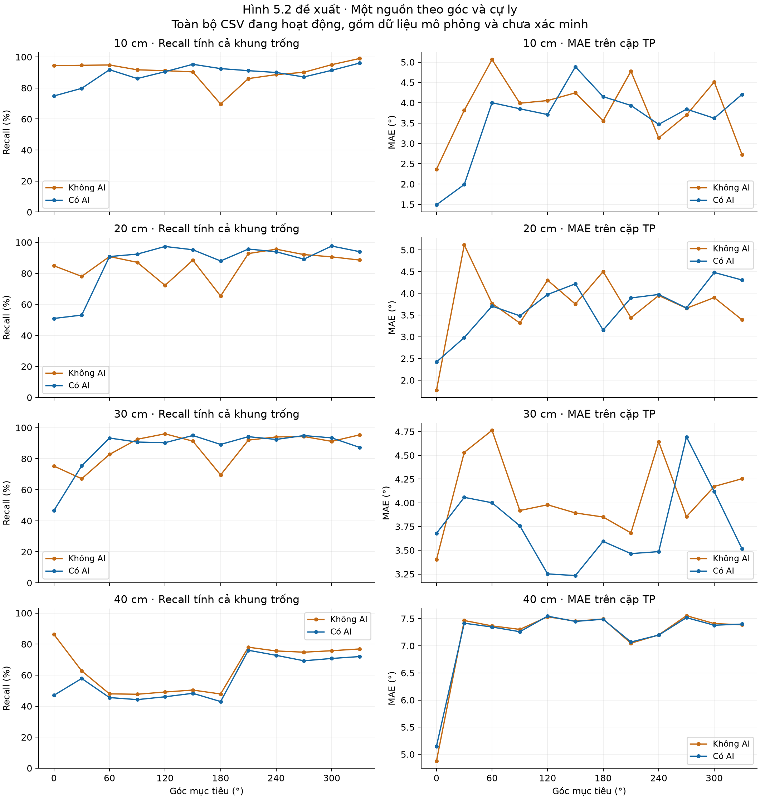
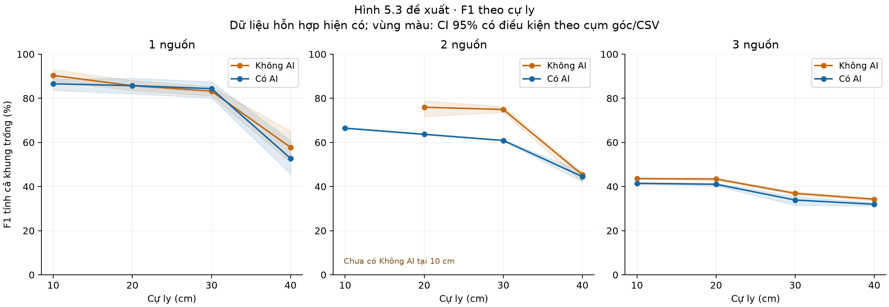
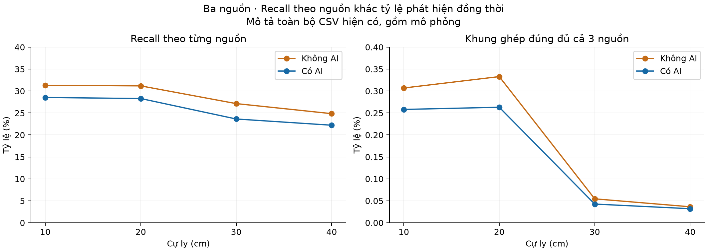

# Đánh giá dữ liệu và nội dung có thể bổ sung vào báo cáo NCKH

Ngày đối chiếu: 16/10/2026, múi giờ Asia/Bangkok.

## Kết quả có thể điền

Tính được số liệu mô tả cho 23/24 dòng của Bảng 5.2–5.3: Không AI 11/12 dòng, Có AI 12/12 dòng. Có thể dựng Hình 5.2 và Hình 5.3 với phần thiếu được ghi rõ. Chưa đủ căn cứ coi toàn bộ các số này là kết quả đo phần cứng trong đúng điều kiện thực nghiệm của bài.

## Kiểm tra hiện trạng

Đã đối chiếu SHA-256 của toàn bộ 13.782 CSV, tổng 16.216.648 dòng, và hồ sơ nguồn với lần kiểm định 15/10/2026: không có file mới, bị xóa hay thay nội dung. Tái sử dụng kiểm định trên đúng nội dung đã xác minh, rồi tính lại các tổng TP/FP/FN và độ phủ cho lần đánh giá này. Không sửa CSV, nhãn nguồn, dấu thời gian hoặc PDF. Chỉ cộng các nhánh 0–3sourceAI/NOAI đang hoạt động; bản lưu, báo cáo, tập con và bản xử lý ngoài các nhánh này không được cộng thêm như mẫu độc lập.

| Nguồn gốc | CSV | Dòng |
| --- | --- | --- |
| Khớp bản ghi thu cũ | 149 | 232.800 |
| Mô phỏng có hồ sơ | 13.191 | 15.838.200 |
| Chưa xác minh | 442 | 145.648 |

## Đối chiếu từng bảng và hình Chương 5

| Vị trí trong bài | Mức độ sẵn sàng | Căn cứ và giới hạn |
| --- | --- | --- |
| Bảng 5.1 | Đã có nội dung thiết kế; cần bổ sung bảng độ phủ thực tế | Có 123/144 điều kiện góc–cự ly–chế độ trong kế hoạch có số liệu; có số liệu không đồng nghĩa đã đo đúng quy trình. |
| Bảng 5.2 | Tính được 11/12 dòng | Thiếu 2 nguồn Không AI tại 10 cm. Số liệu gộp hiện tại chưa được xác nhận cùng nền yên tĩnh và cùng tập góc. |
| Bảng 5.3 | Tính được 12/12 dòng | 2 nguồn Có AI tại 40 cm chỉ có 7 CSV, 2.100 khung, một cặp (120°,240°); không có cặp góc chung với Không AI tại 40 cm. |
| Hình 5.1 | CSV không cung cấp ảnh bố trí thực nghiệm | Có thể vẽ sơ đồ từ góc/cự ly; sơ đồ cần ghi rõ đây là bố trí thiết kế hoặc có nhật ký xác nhận. |
| Hình 5.2 | Vẽ được cho 1 nguồn tại cả 4 cự ly | Đã xuất hình theo 12 góc 0°,30°,…,330°. Hình mô tả dữ liệu hỗn hợp hiện có, cần ghi rõ nguồn/điều kiện. |
| Hình 5.3 | Vẽ được 23/24 điểm F1 | Để trống điểm 2 nguồn Không AI tại 10 cm; số liệu hai chế độ chưa đồng nhất bố trí ở mọi nhóm. |
| Bảng 5.4 và Hình 5.4 | Chưa đủ căn cứ điền đối chứng đúng 4 kịch bản nhiễu | Thiếu nhật ký xác nhận loại âm, nguồn quạt/bàn phím tại 90°, hoạt động từng nguồn và cùng cấu hình ở 30 cm. |
| Bảng 5.5 | Chưa điền được | Hai nhánh 0sourceAI và 0sourceNOAI chưa có CSV; cần đo chỉ quạt và chỉ bàn phím. |
| Bảng 5.6 | Bài đã có số, chưa xác minh được cặp bản dựng | Chỉ tìm thấy một cặp build log/map hiện có. Nó cho Flash 90,46 KiB và SRAM 48,99 KiB, khác các giá trị đã ghi trong bài; chưa xác định được phiên bản/cấu hình để thay số. |
| Bảng 5.7 | Chưa điền được từ CSV hướng | Thiếu log thời gian xử lý từng khung, số khối DMA bỏ lỡ và sự kiện bật/tắt nguồn. |
| Bảng 5.8 | Chưa điền đủ được | Thiếu chuỗi điện áp/dòng hoặc phép đo trung bình gắn với từng chế độ. Giá trị 355 mW trong bài chưa xác định được dòng chế độ tương ứng. |

## Các bảng và hình ở Chương 1–4

| Vị trí trong bài | Khả năng bổ sung từ data | Căn cứ cần có |
| --- | --- | --- |
| Bảng 1.1, Bảng 2.1–2.6, Bảng 3.1 | Đã có thông tin lý thuyết/thiết kế; CSV hướng không bổ sung được bằng chứng phần cứng | Đối chiếu tài liệu, hình học microphone, bộ đệm và phiên bản mã. Không suy ra thông số thiết kế chỉ từ phân phối góc. |
| Bảng 3.2 và Hình 3.2 | Không dựng lại được đầy đủ histogram từ CSV hướng | CSV lưu hướng cuối và góc mục tiêu; không chứa 360 ô của radar_histogram, accum_hist và smoothed_hist hoặc mã khung tương ứng. Giữ bản chụp DSP gốc làm căn cứ. |
| Bảng 4.1–4.2 | Mô tả nhãn và định dạng huấn luyện, không phải định dạng data hiện tại | CSV trong data dùng bản tin DOA, không có sound_type, label, bin_count hay 16 band. Không trộn hai loại bản ghi. |
| Bảng 4.3–4.6 và Hình 4.2 | Bài đã có số; không cập nhật từ CSV hướng trong data | Cần dữ liệu đặc trưng ở thư mục AI, phép chia train/validation/test và lịch sử huấn luyện tương ứng; không dùng Precision định hướng thay accuracy hay F1 phân loại KEEP/NOISE. |
| Bảng 4.7 | Không suy ra trọng số mạng từ CSV hướng | Xác minh bằng mô hình/scaler/header C đúng phiên bản. |
| Bảng 4.8 | Có điểm cần cập nhật theo phiên bản firmware được chọn | Bài mô tả cửa sổ 10 và giới hạn thiếu đặc trưng 8, mã hiện có đặt 5 và 4. Không kết luận dữ liệu đã được thu bằng một cấu hình cụ thể chỉ từ nhãn AI trong tên thư mục. |
| Hình 4.3 và đánh giá phân loại tại Mục 4.8 | CSV hướng không đủ để chứng minh tương đương Python–STM32 hoặc phân loại từng lớp | Cần vector chuẩn, điểm dự đoán hai môi trường, nhãn loại âm và ma trận nhầm lẫn. |

## Quy tắc tính

P, R và F1 được gộp từ tổng TP, FP, FN; ghép một–một với dung sai 15°. R và F1 chính tính cả khung trống. MAE chỉ tính trên các cặp TP trong dung sai. Giả định các nguồn tham chiếu được khai báo đều hoạt động ở mọi khung; CSV không có nhãn hoạt động thực tế. Ký hiệu — là chưa có dữ liệu/không xác định, không phải 0.

## Bảng 5.2 – số liệu mô tả Không AI

Bảng số dưới đây sử dụng toàn bộ dữ liệu đang hoạt động ở mỗi nhóm, gồm mô phỏng. Có thể dùng trong mục mô tả tập dữ liệu hỗn hợp; chưa chép thẳng vào bảng kết quả thực nghiệm nền yên tĩnh nếu chưa điều chỉnh mô tả và đối chiếu nguồn.

| Nguồn | Cự ly (m) | MAE (°) | P (%) | R (%) | F1 (%) | CSV | Khung | Bố trí góc |
| --- | --- | --- | --- | --- | --- | --- | --- | --- |
| 1 | 0.1 | 3.81 | 90.63 | 90.10 | 90.36 | 64 | 103.200 | 36 |
| 1 | 0.2 | 3.73 | 85.95 | 85.43 | 85.69 | 66 | 108.000 | 36 |
| 1 | 0.3 | 3.87 | 78.46 | 88.61 | 83.22 | 92 | 154.800 | 36 |
| 1 | 0.4 | 7.00 | 52.16 | 64.73 | 57.77 | 85 | 81.800 | 18 |
| 2 | 0.1 | — | — | — | — | 0 | 0 | 0 |
| 2 | 0.2 | 6.48 | 92.64 | 64.33 | 75.93 | 36 | 3.600 | 7 |
| 2 | 0.3 | 5.91 | 93.63 | 62.46 | 74.93 | 12 | 1.200 | 2 |
| 2 | 0.4 | 7.75 | 58.53 | 36.95 | 45.31 | 11 | 1.100 | 2 |
| 3 | 0.1 | 5.88 | 71.79 | 31.30 | 43.59 | 678 | 202.000 | 220 |
| 3 | 0.2 | 6.43 | 71.37 | 31.18 | 43.39 | 717 | 215.100 | 220 |
| 3 | 0.3 | 6.77 | 57.67 | 27.14 | 36.91 | 703 | 210.900 | 220 |
| 3 | 0.4 | 6.74 | 55.02 | 24.85 | 34.24 | 741 | 222.300 | 220 |

## Bảng 5.3 – số liệu mô tả Có AI

Bảng số dưới đây sử dụng toàn bộ dữ liệu đang hoạt động ở mỗi nhóm, gồm mô phỏng. Có thể dùng trong mục mô tả tập dữ liệu hỗn hợp; chưa chép thẳng vào bảng kết quả thực nghiệm nền yên tĩnh nếu chưa điều chỉnh mô tả và đối chiếu nguồn.

| Nguồn | Cự ly (m) | MAE (°) | P (%) | R (%) | F1 (%) | CSV | Khung | Bố trí góc |
| --- | --- | --- | --- | --- | --- | --- | --- | --- |
| 1 | 0.1 | 3.64 | 84.43 | 88.82 | 86.57 | 59 | 106.200 | 36 |
| 1 | 0.2 | 3.52 | 90.00 | 81.86 | 85.74 | 70 | 126.000 | 36 |
| 1 | 0.3 | 3.89 | 85.07 | 83.69 | 84.37 | 76 | 136.800 | 36 |
| 1 | 0.4 | 6.85 | 56.94 | 49.11 | 52.74 | 60 | 111.848 | 14 |
| 2 | 0.1 | 5.19 | 82.76 | 55.53 | 66.46 | 2.522 | 4.536.600 | 630 |
| 2 | 0.2 | 7.25 | 81.75 | 52.15 | 63.68 | 2.520 | 4.536.000 | 630 |
| 2 | 0.3 | 9.27 | 80.59 | 48.92 | 60.89 | 2.520 | 4.536.000 | 630 |
| 2 | 0.4 | 5.96 | 75.76 | 31.48 | 44.47 | 7 | 2.100 | 1 |
| 3 | 0.1 | 5.89 | 75.79 | 28.53 | 41.46 | 669 | 200.700 | 220 |
| 3 | 0.2 | 6.45 | 74.61 | 28.29 | 41.03 | 688 | 206.400 | 220 |
| 3 | 0.3 | 6.80 | 59.84 | 23.63 | 33.89 | 704 | 211.200 | 220 |
| 3 | 0.4 | 6.74 | 57.03 | 22.22 | 31.98 | 676 | 202.800 | 220 |

## Nhận xét từ dữ liệu

- Nguồn dữ liệu: 13.191 CSV có bằng chứng mô phỏng, 149 CSV khớp bản ghi thu cũ và 442 CSV chưa xác minh. Khớp hồ sơ thu không phải xác nhận độc lập việc thu trên phần cứng. Riêng ba nguồn chưa có file được phân loại khớp hồ sơ thu cũ.

- Khoảng cách: một nguồn suy giảm rõ ở 40 cm; hai nguồn Có AI tại 10–30 cm có Recall toàn khung 55,53% → 52,15% → 48,92% và MAE 5,19° → 7,25° → 9,27°. Điểm 40 cm dùng tập góc khác nên không nối xu hướng như cùng một thiết kế đối chứng.

- Ba nguồn: Recall toàn khung Có AI chỉ 22,22–28,53%; Không AI 24,85–31,30%. Tỷ lệ khung ghép đúng đủ ba nguồn khoảng 0,032–0,263% với AI và 0,036–0,333% không AI. MAE khoảng 5,88–6,80° chỉ mô tả các nguồn đã ghép đúng, không thể đại diện cho khả năng nhận đủ ba nguồn.

- Tác động AI: trong nhóm mô phỏng N2 dùng chung đầu vào, so sánh trọng số đều theo bố trí góc cho thấy Precision tăng khoảng 5,26 điểm % ở một nguồn 40 cm và 2,85–4,52 điểm % ở ba nguồn. Recall toàn khung giảm khoảng 3,26 điểm % và 2,29–2,59 điểm % tương ứng. F1 toàn khung tăng ở một nguồn 40 cm nhưng giảm ở ba nguồn; MAE ba nguồn không giảm nhất quán. Đây là kết quả theo giả định mô phỏng, không phải mức cải thiện đã đo lại bằng mạch.

- So sánh hai nguồn còn thiếu đối chứng: tại 10 cm không có Không AI; tại 40 cm hai chế độ không có cặp góc chung. Tại 20 cm chỉ chung 7 bố trí, tại 30 cm chỉ chung 2 bố trí; AI thuộc bộ mô phỏng trong khi Không AI chưa xác minh nguồn thu.

- Trọng số: một CSV một nguồn Có AI tại 40 cm có 26.248 khung, lớn hơn nhiều file khác. Báo cáo kèm trung bình đều theo file và theo bố trí góc để thấy mức nhạy do cơ cấu mẫu; không thay thế phép gộp TP/FP/FN bằng trung bình phần trăm mà không ghi rõ.

- Lịch sử chọn mẫu: hồ sơ cũ xác nhận từng loại 40 file theo ngưỡng chỉ số dưới 55%. Kết quả trên tập còn lại có nguy cơ thiên lệch lựa chọn; không dùng mức tăng sau khi loại file làm bằng chứng thuật toán tốt hơn.

## Recall, F1 và khung trống

| Nguồn | Chế độ | cm | P (%) | R toàn khung (%) | R có hướng (%) | F1 toàn khung (%) | F1 có hướng (%) | Trống (%) | Đủ nguồn (%) |
| --- | --- | --- | --- | --- | --- | --- | --- | --- | --- |
| 1 | NOAI | 10 | 90.63 | 90.10 | 95.54 | 90.36 | 93.02 | 5.70 | 90.10 |
| 1 | NOAI | 20 | 85.95 | 85.43 | 94.03 | 85.69 | 89.81 | 9.14 | 85.43 |
| 1 | NOAI | 30 | 78.46 | 88.61 | 93.23 | 83.22 | 85.21 | 4.96 | 88.61 |
| 1 | NOAI | 40 | 52.16 | 64.73 | 69.37 | 57.77 | 59.54 | 6.68 | 64.73 |
| 1 | AI | 10 | 84.43 | 88.82 | 92.56 | 86.57 | 88.31 | 4.04 | 88.82 |
| 1 | AI | 20 | 90.00 | 81.86 | 93.31 | 85.74 | 91.63 | 12.28 | 81.86 |
| 1 | AI | 30 | 85.07 | 83.69 | 92.89 | 84.37 | 88.81 | 9.91 | 83.69 |
| 1 | AI | 40 | 56.94 | 49.11 | 68.88 | 52.74 | 62.34 | 28.69 | 49.11 |
| 2 | NOAI | 10 | — | — | — | — | — | — | — |
| 2 | NOAI | 20 | 92.64 | 64.33 | 66.59 | 75.93 | 77.48 | 3.39 | 36.50 |
| 2 | NOAI | 30 | 93.63 | 62.46 | 62.88 | 74.93 | 75.23 | 0.67 | 28.42 |
| 2 | NOAI | 40 | 58.53 | 36.95 | 38.39 | 45.31 | 46.36 | 3.73 | 8.55 |
| 2 | AI | 10 | 82.76 | 55.53 | 65.08 | 66.46 | 72.86 | 14.68 | 36.83 |
| 2 | AI | 20 | 81.75 | 52.15 | 63.08 | 63.68 | 71.21 | 17.33 | 32.92 |
| 2 | AI | 30 | 80.59 | 48.92 | 61.12 | 60.89 | 69.52 | 19.95 | 29.48 |
| 2 | AI | 40 | 75.76 | 31.48 | 46.58 | 44.47 | 57.69 | 32.43 | 7.00 |
| 3 | NOAI | 10 | 71.79 | 31.30 | 36.95 | 43.59 | 48.79 | 15.28 | 0.31 |
| 3 | NOAI | 20 | 71.37 | 31.18 | 36.96 | 43.39 | 48.69 | 15.64 | 0.33 |
| 3 | NOAI | 30 | 57.67 | 27.14 | 30.67 | 36.91 | 40.04 | 11.51 | 0.05 |
| 3 | NOAI | 40 | 55.02 | 24.85 | 29.18 | 34.24 | 38.14 | 14.85 | 0.04 |
| 3 | AI | 10 | 75.79 | 28.53 | 36.25 | 41.46 | 49.04 | 21.29 | 0.26 |
| 3 | AI | 20 | 74.61 | 28.29 | 35.93 | 41.03 | 48.51 | 21.26 | 0.26 |
| 3 | AI | 30 | 59.84 | 23.63 | 29.45 | 33.89 | 39.47 | 19.75 | 0.04 |
| 3 | AI | 40 | 57.03 | 22.22 | 28.15 | 31.98 | 37.70 | 21.09 | 0.03 |

## Đối chiếu trên bố trí góc chung

Chênh lệch AI − Không AI, tính trung bình đều theo bố trí góc chung. Đây là phân tích độ nhạy thành phần mẫu; cùng góc chưa đủ bảo đảm cùng điều kiện thu. Không dùng bảng này như ước lượng tác động nhân quả trên phần cứng.

| Nguồn | cm | Bố trí góc chung | CSV AI / Không AI | ΔP (điểm %) | ΔR (điểm %) | ΔF1 (điểm %) | ΔMAE (°) |
| --- | --- | --- | --- | --- | --- | --- | --- |
| 1 | 10 | 36 | 59 / 64 | -6.42 | -3.57 | -5.39 | -0.23 |
| 1 | 20 | 36 | 70 / 66 | 2.46 | 0.25 | 0.96 | -0.09 |
| 1 | 30 | 36 | 76 / 92 | 3.80 | 0.31 | 1.91 | -0.03 |
| 1 | 40 | 14 | 60 / 53 | 1.86 | -12.63 | -5.90 | -0.02 |
| 2 | 10 | 0 | 0 / 0 | — | — | — | — |
| 2 | 20 | 7 | 28 / 36 | -3.93 | -8.86 | -7.71 | 0.86 |
| 2 | 30 | 2 | 8 / 12 | -10.73 | -13.14 | -13.11 | 3.22 |
| 2 | 40 | 0 | 0 / 0 | — | — | — | — |
| 3 | 10 | 220 | 669 / 678 | 4.25 | -2.64 | -1.96 | 0.02 |
| 3 | 20 | 220 | 688 / 717 | 4.27 | -2.66 | -1.93 | 0.02 |
| 3 | 30 | 220 | 704 / 703 | 2.72 | -2.42 | -1.83 | 0.02 |
| 3 | 40 | 220 | 676 / 741 | 2.78 | -2.35 | -1.82 | 0.01 |

## Độ phủ thiết kế và số khung

- Một nguồn: đủ 12 góc bước 30° ở cả hai chế độ và bốn cự ly trên tập đang hoạt động, nhưng nguồn gốc và điều kiện nền không đồng nhất.

- Hai nguồn: cấu hình (0°,45°) chưa có ở cả hai chế độ tại mọi cự ly; nhiều cặp góc khác trong kế hoạch cũng còn thiếu. Các góc (120°,240°) của nhóm AI 40 cm không thay thế bốn cặp dự kiến trong Bảng 5.1.

- Ba nguồn: cả hai bộ ba góc dự kiến đều có dữ liệu ở bốn cự ly, song bộ mô phỏng chủ yếu có 300 khung/CSV. Không thể coi ba file 300 khung là ba lần đo 1.000 khung như quy trình đã ghi.

- Đã có số liệu ở 123/144 điều kiện góc–cự ly–chế độ dự kiến. Con số này đo độ phủ dữ liệu, không chứng minh đã hoàn thành quy trình thực nghiệm hoặc độc lập giữa các lần thu.

| Nguồn | Chế độ | cm | Góc còn thiếu |
| --- | --- | --- | --- |
| 2 | NOAI | 10 | 0; 45 |
| 2 | NOAI | 10 | 0; 60 |
| 2 | NOAI | 10 | 0; 90 |
| 2 | NOAI | 10 | 0; 180 |
| 2 | NOAI | 20 | 0; 45 |
| 2 | NOAI | 20 | 0; 60 |
| 2 | NOAI | 20 | 0; 180 |
| 2 | NOAI | 30 | 0; 45 |
| 2 | NOAI | 30 | 0; 60 |
| 2 | NOAI | 30 | 0; 180 |
| 2 | NOAI | 40 | 0; 45 |
| 2 | NOAI | 40 | 0; 60 |
| 2 | NOAI | 40 | 0; 90 |
| 2 | NOAI | 40 | 0; 180 |
| 2 | AI | 10 | 0; 45 |
| 2 | AI | 20 | 0; 45 |
| 2 | AI | 30 | 0; 45 |
| 2 | AI | 40 | 0; 45 |
| 2 | AI | 40 | 0; 60 |
| 2 | AI | 40 | 0; 90 |
| 2 | AI | 40 | 0; 180 |

## Độ nhạy với trọng số tổng hợp

| Nguồn | Chế độ | cm | F1 gộp (%) | F1 đều file (%) | F1 đều góc (%) |
| --- | --- | --- | --- | --- | --- |
| 1 | NOAI | 10 | 90.36 | 91.01 | 91.89 |
| 1 | NOAI | 20 | 85.69 | 85.85 | 86.72 |
| 1 | NOAI | 30 | 83.22 | 83.30 | 83.88 |
| 1 | NOAI | 40 | 57.77 | 62.31 | 61.56 |
| 1 | AI | 10 | 86.57 | 86.78 | 86.50 |
| 1 | AI | 20 | 85.74 | 84.58 | 87.68 |
| 1 | AI | 30 | 84.37 | 82.74 | 85.78 |
| 1 | AI | 40 | 52.74 | 49.66 | 53.70 |
| 2 | NOAI | 10 | — | — | — |
| 2 | NOAI | 20 | 75.93 | 75.75 | 71.44 |
| 2 | NOAI | 30 | 74.93 | 74.85 | 74.92 |
| 2 | NOAI | 40 | 45.31 | 45.34 | 44.28 |
| 2 | AI | 10 | 66.46 | 66.35 | 66.47 |
| 2 | AI | 20 | 63.68 | 63.60 | 63.68 |
| 2 | AI | 30 | 60.89 | 60.81 | 60.89 |
| 2 | AI | 40 | 44.47 | 44.38 | 44.47 |
| 3 | NOAI | 10 | 43.59 | 43.64 | 43.55 |
| 3 | NOAI | 20 | 43.39 | 43.40 | 43.06 |
| 3 | NOAI | 30 | 36.91 | 36.92 | 36.70 |
| 3 | NOAI | 40 | 34.24 | 34.24 | 33.89 |
| 3 | AI | 10 | 41.46 | 41.43 | 41.59 |
| 3 | AI | 20 | 41.03 | 40.96 | 41.13 |
| 3 | AI | 30 | 33.89 | 33.55 | 34.87 |
| 3 | AI | 40 | 31.98 | 31.88 | 32.07 |

## Chất lượng, lặp và thời gian lưu

Còn 8.604 khung có hướng trùng trong cùng khung, 122 chuỗi khung trống dài và 6 file chỉ có tiêu đề; tổng 14.188 dòng nằm trong các cờ nghi vấn. Các dòng được giữ nguyên. Góc giống nhau giữa các khung có thể do nguồn đứng yên, lượng tử hóa hoặc làm trơn, không tự chứng minh lỗi. Không đặt một tỷ lệ lặp mục tiêu để sửa số đo. Độ dài chuỗi lặp và tự tương quan cần được đọc cùng nhau; không xem mọi khung là phép thử độc lập. Các kiểm định phân phối, vòng tròn, chuỗi và bootstrap của lần kiểm định trước vẫn áp dụng vì nội dung giữ nguyên. P-value không được dùng để xác nhận dữ liệu là đo thật.

Đã ghi nhận thời điểm sửa trên ổ đĩa của mọi CSV như thông tin phụ, không dùng để phân loại nguồn dữ liệu hay loại mẫu. Không CSV nào có thời gian từng khung trong tiêu đề hiện tại. Thời điểm lưu có thể phản ánh sao chép/chỉnh định dạng, chưa đủ để suy ra thời gian thu hoặc nhịp khung thực tế. Chưa xác minh được thời lượng thu cho toàn bộ tập. Ví dụ 2.000 khung/90 giây chỉ tương đương giả định 22,22 khung/giây, không phải thời lượng đã được xác nhận cho những file này. Lần thu tiếp theo cần JSON gắn với checksum CSV, ghi thời điểm bắt đầu/kết thúc, lưu xong, số khung và mã khung mạch nếu có.

Tỷ lệ góc giữ nguyên dưới đây chỉ xét các cặp hướng ở hai khung kề nhau đều có hướng; ghép theo độ dịch vòng nhỏ nhất. Không xác nhận danh tính nguồn, không nối qua khung trống.

| Nguồn | Chế độ | cm | Nguồn gốc | CSV | Cặp góc giữ nguyên (%) | Trung vị file (%) | Chuỗi góc dài nhất | Chuỗi trống dài nhất |
| --- | --- | --- | --- | --- | --- | --- | --- | --- |
| 1 | AI | 10.0 | Khớp bản ghi thu cũ | 10 | 49.00 | 49.07 | 19 | 67 |
| 1 | AI | 10.0 | Mô phỏng có hồ sơ | 49 | 7.55 | 7.18 | 6 | 0 |
| 1 | AI | 20.0 | Khớp bản ghi thu cũ | 19 | 44.92 | 45.24 | 14 | 266 |
| 1 | AI | 20.0 | Mô phỏng có hồ sơ | 51 | 7.05 | 6.80 | 6 | 0 |
| 1 | AI | 30.0 | Khớp bản ghi thu cũ | 12 | 44.55 | 44.38 | 21 | 175 |
| 1 | AI | 30.0 | Mô phỏng có hồ sơ | 64 | 5.98 | 5.92 | 5 | 0 |
| 1 | AI | 40.0 | Mô phỏng có hồ sơ | 36 | 14.85 | 14.98 | 6 | 42 |
| 1 | AI | 40.0 | Chưa xác minh | 24 | 60.56 | 61.55 | 16 | 128 |
| 1 | NOAI | 10.0 | Khớp bản ghi thu cũ | 43 | 34.46 | 33.47 | 17 | 38 |
| 1 | NOAI | 10.0 | Mô phỏng có hồ sơ | 21 | 11.07 | 8.72 | 7 | 0 |
| 1 | NOAI | 20.0 | Khớp bản ghi thu cũ | 31 | 33.13 | 32.94 | 15 | 45 |
| 1 | NOAI | 20.0 | Mô phỏng có hồ sơ | 35 | 9.19 | 8.34 | 10 | 0 |
| 1 | NOAI | 30.0 | Khớp bản ghi thu cũ | 21 | 30.28 | 29.53 | 9 | 61 |
| 1 | NOAI | 30.0 | Mô phỏng có hồ sơ | 71 | 6.70 | 6.31 | 7 | 0 |
| 1 | NOAI | 40.0 | Mô phỏng có hồ sơ | 36 | 15.14 | 15.21 | 6 | 5 |
| 1 | NOAI | 40.0 | Chưa xác minh | 49 | 25.54 | 25.64 | 7 | 9 |
| 2 | AI | 10.0 | Khớp bản ghi thu cũ | 12 | 62.27 | 62.29 | 16 | 31 |
| 2 | AI | 10.0 | Mô phỏng có hồ sơ | 2.508 | 54.27 | 57.91 | 29 | 78 |
| 2 | AI | 10.0 | Chưa xác minh | 2 | 44.35 | 44.31 | 6 | 7 |
| 2 | AI | 20.0 | Mô phỏng có hồ sơ | 2.520 | 51.73 | 55.08 | 29 | 79 |
| 2 | AI | 30.0 | Mô phỏng có hồ sơ | 2.520 | 51.56 | 54.34 | 37 | 100 |
| 2 | AI | 40.0 | Chưa xác minh | 7 | 66.90 | 66.50 | 20 | 33 |
| 2 | NOAI | 20.0 | Chưa xác minh | 36 | 57.82 | 59.13 | 11 | 10 |
| 2 | NOAI | 30.0 | Chưa xác minh | 12 | 59.32 | 59.56 | 14 | 4 |
| 2 | NOAI | 40.0 | Chưa xác minh | 11 | 52.10 | 53.21 | 14 | 5 |
| 3 | AI | 10.0 | Mô phỏng có hồ sơ | 660 | 16.46 | 15.70 | 10 | 31 |
| 3 | AI | 10.0 | Chưa xác minh | 9 | 64.98 | 64.29 | 16 | 24 |
| 3 | AI | 20.0 | Mô phỏng có hồ sơ | 660 | 15.71 | 14.49 | 7 | 32 |
| 3 | AI | 20.0 | Chưa xác minh | 28 | 59.83 | 66.24 | 21 | 31 |
| 3 | AI | 30.0 | Mô phỏng có hồ sơ | 660 | 12.39 | 11.12 | 6 | 23 |
| 3 | AI | 30.0 | Chưa xác minh | 44 | 71.28 | 70.77 | 19 | 114 |
| 3 | AI | 40.0 | Mô phỏng có hồ sơ | 660 | 13.36 | 12.23 | 6 | 25 |
| 3 | AI | 40.0 | Chưa xác minh | 16 | 69.77 | 68.95 | 20 | 51 |
| 3 | NOAI | 10.0 | Mô phỏng có hồ sơ | 660 | 16.57 | 15.99 | 10 | 20 |
| 3 | NOAI | 10.0 | Chưa xác minh | 18 | 37.29 | 38.33 | 5 | 19 |
| 3 | NOAI | 20.0 | Mô phỏng có hồ sơ | 660 | 15.91 | 14.83 | 7 | 25 |
| 3 | NOAI | 20.0 | Chưa xác minh | 57 | 36.07 | 35.97 | 7 | 28 |
| 3 | NOAI | 30.0 | Mô phỏng có hồ sơ | 660 | 12.76 | 11.75 | 6 | 11 |
| 3 | NOAI | 30.0 | Chưa xác minh | 43 | 28.38 | 27.41 | 5 | 13 |
| 3 | NOAI | 40.0 | Mô phỏng có hồ sơ | 660 | 13.60 | 12.61 | 6 | 16 |
| 3 | NOAI | 40.0 | Chưa xác minh | 81 | 29.13 | 28.79 | 6 | 20 |

## Nội dung cần sửa trong bài

- Mục 5.1: bổ sung bảng số CSV, số khung, bố trí góc, nguồn gốc dữ liệu và cự ly thực có. Tách rõ kết quả mô phỏng có hồ sơ, khớp bản ghi thu cũ và chưa xác minh; có thể giữ bảng gộp hiện trạng như phân tích bổ sung có ghi rõ thành phần.

- Mục 5.1.2: ghi đúng số khung đã dùng, mức lặp và thiếu nhật ký phiên thu. Không giữ nguyên tuyên bố mọi trường hợp đã đo 1.000 khung × ít nhất ba lần nếu dữ liệu không đáp ứng.

- Bảng 5.2–5.3: ghi R/F1 tính cả khung trống theo quy tắc hiện tại của bài. Nếu muốn thêm R/F1 bỏ khung trống, dùng cột hoặc bảng phụ riêng. Ghi rõ nền âm thanh chưa xác minh ở nhóm nào và không gán bộ N2 mô phỏng là nền yên tĩnh.

- Mục 5.2.3: bổ sung tỷ lệ ghép đúng đủ số nguồn, đặc biệt với ba nguồn. Phân tích suy giảm theo độ tách góc trong cùng nguồn gốc/điều kiện, tránh trộn khác cự ly và khác bộ dữ liệu thành một quan hệ nhân quả.

- Mục 5.3: mô tả AI là bộ chọn hướng theo loại âm; mô phỏng N2 hiện có dùng đầu vào chung, không thay thế phép đo quạt/bàn phím cố định 90° tại 30 cm. Người dùng xác nhận mục tiêu là giọng nói; câu trong bài ghi cả âm nhạc thuộc KEEP cần đối chiếu lại nhãn huấn luyện.

- Mục 5.4: xác minh cặp build log/map tương ứng hai chế độ, phiên bản firmware và cấu hình. Bài mô tả lịch sử AI 10 và bước khung 256 mẫu, trong khi mã hiện tại đặt AI_WINDOW_SIZE=5, thu đủ 512 mẫu rồi đặt lại chỉ số về 0 và không thấy thao tác giữ nửa khung trong hàm thu; cần xác nhận đúng phiên bản trước khi dùng ngân sách 16 ms cho mã hiện tại.

- Mục 5.5–5.6: để trống các ô điện năng, độ trễ, DMA và nhiễu chưa có phép đo tương ứng. Kết luận hiện có chỉ hỗ trợ mô tả đánh đổi Precision–Recall dưới điều kiện/giả định được nêu, chưa chứng minh AI cải thiện toàn diện hoặc nhận đồng thời ba nguồn ổn định.

## Đoạn văn có thể sử dụng sau khi ghi rõ nguồn và điều kiện

Dữ liệu được đánh giá bằng ghép một–một giữa hướng dự đoán và hướng tham chiếu, sử dụng sai số góc vòng với dung sai 15°. Precision, Recall và F1 được tổng hợp từ số đếm TP, FP và FN. Recall và F1 chính bao gồm mọi khung, kể cả khung không có hướng. MAE chỉ tính trên các cặp TP; do đó MAE được diễn giải cùng Recall và tỷ lệ khung phát hiện đúng đủ số nguồn.

Tập dữ liệu hiện trạng gồm 13.782 CSV với 16.216.648 dòng; có 6 file chỉ chứa tiêu đề nên không góp khung đánh giá. Đối chiếu hồ sơ nguồn xác định 13.191 file mô phỏng có tài liệu, 149 file khớp bản ghi thu lịch sử và 442 file chưa xác minh. Các thống kê gộp mô tả tập dữ liệu hiện có; chúng không được dùng thay cho toàn bộ kết quả đo phần cứng ở nền yên tĩnh hoặc các kịch bản nhiễu chưa được xác nhận.

Trong nhóm mô phỏng có chung đầu vào, bộ lọc AI làm tăng Precision nhưng đồng thời loại bỏ một phần hướng phù hợp mục tiêu, dẫn tới giảm Recall tính trên mọi khung. Với ba nguồn, tỷ lệ phát hiện đúng đủ ba nguồn còn thấp dù MAE trên các cặp TP ở mức vài độ. Vì vậy, chưa thể kết luận MAE thấp phản ánh khả năng định hướng đầy đủ hoặc AI cải thiện đồng thời mọi chỉ số.

## Hình đã xuất

## Tái kiểm tra và dữ liệu đối chứng

inventory.json lưu SHA-256 của mọi đầu vào và thông tin thời điểm sửa chỉ để đối chiếu. assessment.json chứa số đếm, kết quả và độ phủ. Kiểm định thống kê chi tiết được tham chiếu tới báo cáo kiểm định ngày 15/10/2026 vì toàn bộ nội dung CSV và hồ sơ nguồn vẫn khớp.

Bài được đối chiếu: paper/Báo cáo NCKH.pdf, SHA-256 4882618eca669b6610ebdf3ce5a5df87adbdb3f93cd90b6b22c2c1b147d77a24.

Không thay dữ liệu gốc, không thêm nhiễu, không thay dấu thời gian, không bổ sung mẫu hoặc xóa điểm khác phân phối.
